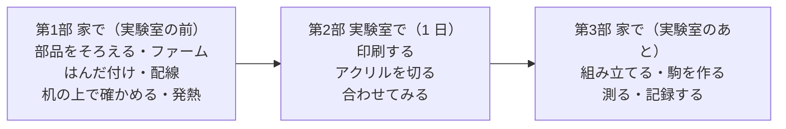

# 1マス試作ガイド（段階1: 手で動かす台車）

2026-11-21 作成（Claude Docs の「1マス試作 完全ガイド」を作り直した）、本田

このガイドの順に進めると、1 マス分の試作を完成させられます。制作計画（`plans/2026-10-30_realtime-hasami-board.md`）の「判断1」の測定まで終わります。使うのは、届いている部品、実験室の 3D プリンターとレーザーカッター、家のはんだごてだけです。モーターはまだないので、電磁石を載せた台車を手で動かします（段階1）。速さを決めた引っぱり（50mm/s）だけは、モーターをそろえてから測ります（段階2、付録）。

作業は「家（実験室の前）」「実験室（1 日）」「家（実験室のあと）」の 3 部に分けてあります。どの部も上から順に進めれば済み、ほかの部へ戻って読む必要はありません。各手順の最後の「確認」ができたら、次へ進んでください。

測った値は `hardware/test-log.md` に書きます。印刷する部品のデータ（STL）と、STL を作るプログラムは `hardware/rig/` にあります。

## 完成するもの


- 印刷した「台」の溝を、電磁石を載せた「台車」が走る。台車は長い取っ手を持ち、手で押し引きする
- 台の壁の上に「格子板」（3 マス分）と乳白アクリルを載せる。真ん中のマスの真下にセンサーを、センサーから 8mm 手前に LED を置く
- 駒の磁石から電磁石までは 7mm。印刷した部品を組めばこの距離になるので、測る道具は要らない
- ESP32 とブレッドボードをジャンパーでつなぎ、PC からコマンドを打って測る

## 進め方



実験室でしかできない作業は、3D プリンターでの印刷と、レーザーカッターでのアクリル切断だけです。この 2 つを同じ日に済ませれば、実験室は 1 回で足ります。はんだ付けや配線、ファームの書き込みは、印刷した部品がなくてもできます。机の上での動作確認や電磁石の発熱の測定も同様なので、これらは実験室の前に家で済ませます。

進み具合のチェックリストです。終わったものに印を付けてください。

- [ ] 第1部 家で（実験室の前）: A1〜A9
- [ ] 第2部 実験室で: B1〜B4
- [ ] 第3部 家で（実験室のあと）: C1〜C9
- [ ] `hardware/test-log.md` の「判断1の結論」を書いた

## 安全のきまり

作業の前に読んでください。

- 12V の線は、TB67H450 の VM にだけつなぐ。12V が 3.3V や 5V の側に入ると、ESP32 とセンサーはその場で壊れる
- 配線を変えるときは、USB と AC アダプターを両方抜く。作業が終わったら AC アダプターをコンセントから抜く
- ただし、`pole` が「reversed」を出して電磁石の 2 本の線（左 16 と左 18）を入れかえるときだけは、AC アダプターのプラグを抜けば USB は挿したままでよい（12V が来ていなければ、電磁石の線には電気が流れない）
- 煙、こげたにおい、異常に熱い部品に気づいたら、すぐに AC アダプターと USB を抜く
- 電磁石は通電を続けると熱くなる（販売元の注意書きがある）。`heat` 以外で 30 秒より長く通電しない。`heat` の直後は吸着面に触らず、温度計で測る
- ネオジム磁石どうしは強く引き合い、指を挟んだり、ぶつかって割れたりする。付け外しは横に滑らせて行う。PC、カード、時計、ペースメーカーを使う人には近づけない
- はんだごては、使わないときは必ずこて台に置く。作業中は換気し、終わったら電源を切る
- アクリルを折るときは、切り口と破片で手を切らないように軍手をする

---

## 第1部 家で（実験室の前）

第1部では、印刷した部品がなくてもできる作業をすべて済ませます。センサー、LED、電磁石はまだ格子板や台車に付けず、机の上に置いたまま配線します。

### A1 部品と道具をそろえる

届いている部品（この試作で使う分）です。

| 部品 | 品名 | 使う数 | 使い道 |
| --- | --- | --- | --- |
| ESP32 | ESP32-DevKitC-32E | 1 | ファームを動かす。PC の USB から給電し、3.3V と 5V もここから取る |
| ホールセンサー | DRV5053OAQLPG（OA）と DRV5053PAQLPG（PA） | 各 1 | 駒の磁石を読む。先に OA、あとで PA に付け替えて比べる |
| 電磁石 | ZYE1-P25/20 | 1 | 台車に載せて駒を引く |
| H ブリッジ | AE-TB67H450 | 1 | 電磁石に 12V を流し、向きと強さを切り替える |
| LED | AE-WS2812B | 1（もう 1 つは予備） | 台座の輪を光らせる |
| 電圧変換 | SN74AHCT125N | 1 | ESP32 の 3.3V の信号を、LED 用の 5V にする |
| AC アダプター | AD-A120P300（12V 3A） | 1 | 電磁石の電源 |
| DC ジャック | AE-DC-POWER-JACK-DIP | 1 | アダプターをブレッドボードにつなぐ |
| ブレッドボード | EIC-3901 | 1 | 配線 |
| ジャンパー | オス-オス（14 種類×10 本）、オス-メス（15cm） | オス-オス 14 本、オス-メス 7 本（曲がるジャンパーが 20cm なら、電磁石の線を延ばすのにもう 2 本） | オス-オスはブレッドボードの中、オス-メスは ESP32 とブレッドボードの間 |
| 駒の磁石 | φ10×2mm | 6 | 1 つの駒に 1〜3 枚 |

モーター、1 軸の機構、5V の降圧、LED テープ、M3 のねじは、段階1 では要りません。LED と 74AHCT125 に使う 5V は、ESP32 の 5V のピン（USB から来る）で足ります。

買い足すものは 2 つです。

| 買うもの | 選び方 | 使い道 |
| --- | --- | --- |
| 乳白アクリル板 | 乳白半透明、厚さ 2mm、「アクリル」と書かれた板。短い辺 55mm 以上・長い辺 130mm 以上で、300×300mm くらいまで（レーザーカッターの台に載る大きさ） | 118×43mm を 1 枚切り出し、駒を載せる面にする |
| 曲がるオス-オスのジャンパー | 長さ 20〜30cm、ばらして使えるもの（40 本入りなど）を 1 袋 | センサー（OA と PA）、LED、電磁石から延ばす線に 11 本（予備も作るなら 17 本） |

アクリルの代わりに、見た目の似た塩ビ板（塩化ビニル）を買ってはいけません。レーザーで切ると塩素を含む有害なガスが出て、機械も傷めます。ポリカーボネート板も、レーザーでは焦げてきれいに切れません。

届いているオス-オスの 14 種類×10 本は、ブレッドボードに挿すための短い単線のセットです。長さが足りず、曲げを繰り返すと折れるため、部品から延ばす線には使えません。

必ず要る道具です。

- はんだごて、こて台、はんだ
- ニッパー（線の先や部品の足を切る。被覆をむくのにも使える）
- M4 のねじに合うドライバー、定規
- マスキングテープ（センサーの当てもの、線の固定、印に使う）、油性ペン
- PC（Windows）と、データ通信できる Micro USB ケーブル
- M4 のなべねじ（長さ 8mm 前後）1 本。電磁石を台車に留める
- 温度計（A8 で電磁石の発熱を測る）
- 厚紙（A6・A7 で使う。2〜3 枚）と、同じくらいの厚さの本 2 冊（A5・A6 で使う）

あれば使うものです。なくても進められます。

- 熱収縮チューブとヒートガン（はんだのつなぎ目を包む）。なければビニールテープで包む。ビニールテープもなければマスキングテープで代用する。この試作は 12V 以下なので、つなぎ目どうしが触れなければ十分
- セラミックコンデンサー 0.01µF（「103」と書いてある）と 0.1µF（「104」）。電源のノイズを抑える部品で、なくても段階1 の測定はできる
- ワイヤーストリッパー（被覆をむくのが楽になる）
- 紙やすり（印刷した部品のきつい所を削る。なければカッター）
- 合板（30×20cm くらい）とドリル、M4 のねじ（長さ 10〜12mm）4 本。台を合板に留めるときに使う。なければ両面テープで台を机に留める

コンデンサーがないときは、A3 と A4 の「コンデンサー」の手順を飛ばします。熱収縮チューブがないときは、「熱収縮チューブで包む」とある所をテープで包みます。

確認: 必ず要る道具がそろい、アクリル板とジャンパーを注文した。届くまでの間に進めてよいのは、A2（ファーム）と、A3 のうち TB67H450 と DC ジャックのはんだ付けまで。電磁石、センサー、LED の線と A4 の配線には、買い足したジャンパーが要る。

### A2 ファームを書き込む

ESP32 に測定用のプログラム（rig ファーム）を書き込みます。このプログラムは、PC から短いコマンドを打つと、センサーの値を読んだり電磁石を動かしたりします。ESP32 に何もつないでいなくても書き込めます。この手順では、AC アダプターは使いません。

初回だけ、書き込み用のソフトを入れます。PlatformIO が必要なファイルを自動で落とすため、ネットにつながる場所で行います。

1. Visual Studio Code（VS Code）を公式サイトから入れる。
2. VS Code の左の「拡張機能」（四角が 4 つのアイコン）で「PlatformIO IDE」を検索して入れる。入り終わると、左に蟻の顔のアイコンが出る。初回は準備に数分かかる。
3. GitHub のリポジトリ（SoyaHonda/hasami-shogi）を開き、ブランチが main になっているか確かめる。「Code」→「Download ZIP」を押して ZIP を落とし、展開する。前に落とした ZIP があっても、更新されていることがあるので落とし直す。
4. VS Code の「ファイル」→「フォルダーを開く」で、展開したフォルダーのうち `platformio.ini` が入っている階層を開く。

ESP32 を PC につなぎます。

1. ESP32 を Micro USB ケーブルで PC につなぐ。基板の赤い LED が点く。
2. Windows の「デバイス マネージャー」を開き、「ポート (COM と LPT)」を確認する。「Silicon Labs CP210x USB to UART Bridge (COM3)」のような行が出ていればよい（COM の番号は PC によって違う）。
3. ポートが出ないときは、充電専用のケーブルを使っていることが多いので、別のケーブルを試す。それでも出なければ、Silicon Labs のサイトから CP210x の VCP ドライバーを入れる。

ファームを書き込みます。

1. VS Code の一番下の青い帯（ステータスバー）で、環境の名前（「Default」など）を押す。一覧から「env:rig」を選ぶ。esp32dev は本番用なので選ばない。
2. 同じ帯の「→」（Upload）を押す。初回は必要なツールとライブラリを落とすので、数分かかる。
3. 下に開いた画面に「Connecting....」と出て進まないときは、ESP32 の「BOOT」ボタンを押し続ける。「Writing」と出たら離す。
4. 「SUCCESS」と出たら書き込みは終わり。

ターミナルで書き込むときは、PlatformIO のアイコンから「New Terminal」を開いて次を打ちます。

```bash
pio run -e rig -t upload
```

コマンドを打つ画面（シリアルモニター）を開きます。

1. 青い帯のコンセントの形のアイコン（Serial Monitor）を押す。通信の速さは `platformio.ini` で 115200 に決めてあるので、設定は要らない。
2. ESP32 の「EN」ボタンを押して再起動する。画面に「hasami rig ready」と、使えるコマンドの一覧が出る。
3. コマンドを打って Enter を押す。打った文字は画面に出る。`hall` のように表示が流れ続けるコマンドは、何かキーを 1 つ押すと止まる。
4. 書き込み直す前には、シリアルモニターの画面で Ctrl+C を押して閉じる（開いたままだと書き込みに失敗する）。

このガイドで使うコマンドの一覧は、付録の「rig のコマンド」にあります。

確認: シリアルモニターに「hasami rig ready」が出て、`hall` と打つと数字の行が流れ、キーを押すと止まる（センサーをつなぐ前なので、数字はでたらめでよい）。

### A3 はんだ付けをする

はんだ付けは 5 か所です。予備として、LED とセンサー（OA）をもう 1 つずつ同じように作っておくと、あとで壊したときにすぐ替えられます。

はんだ付けのこつです。こて先で足と穴を 2 秒ほど温め、はんだを流し、はんだを離してからこてを離します。つやのある山の形になれば良い付き方です。センサーやコンデンサーの足は、同じ所を 3 秒以上温め続けないようにします。テスターがないので、終わったら必ず近くで目視します。隣の足や線どうしがはんだでつながっていないか確かめます。

部品に付ける線は、買い足した曲がるジャンパーで作ります。

1. ジャンパーの片方の端のオスのピンを、ニッパーで切り落とす。残したオスのピンは、ブレッドボードに挿すのに使う。
2. 切った側の被覆を 5mm むく。ワイヤーストリッパーがないときは、線の先から 5mm の所をニッパーの刃で軽く挟む。握り切らずに線を 1 回転させ、被覆にぐるりと切れ目を入れる。刃を少しゆるめて切れ目に引っかけたまま、線の先へ引き抜くと被覆が抜ける。
3. 中の芯線を指でよってまとめ、はんだを薄くなじませる。芯線が何本も切れてしまったら、その部分を切り落としてやり直す。
4. 熱収縮チューブを使うときは、はんだ付けの前に線に通しておく。

初めてなら、余ったジャンパーで 2、3 回練習してから始めると安心です。

#### TB67H450 のモジュールにピンを付ける

1. 付属の 1×8 のピンヘッダーを、長い側を下にしてブレッドボードに挿す（まっすぐ付けるための支えにする）。
2. TB67H450 のモジュールをピンヘッダーの上にかぶせ、8 本をはんだ付けする。
3. 基板に印刷された文字（シルク）で、ピンの名前を確かめる。データシートでは GND、IN2、IN1、VREF、VM、OUT1、RS、OUT2 の順になっている。ただし、配線は必ず実物のシルクの名前で行う。並んでいる順に名前を紙へ写しておくと、配線のときに迷わない。

#### DC ジャックを組む

1. DC ジャックと 3 本のピンを、基板にはんだ付けする（ピンはブレッドボードを支えにして挿す）。
2. 基板のシルクで、どのピンが＋（12V）、どれが−（GND）かを確かめ、紙に書く。3 本目はどこにもつながっていない（NC）。AC アダプターは中心が＋。

#### 電磁石の線を延ばす

電磁石のリード線は約 23mm しかないので、曲がるジャンパーをつないで延ばします。

1. 曲がるジャンパー 2 本の、片方のオスのピンを切り落とす。
2. 電磁石の 2 本のリード線に、それぞれはんだ付けする。
3. つなぎ目を熱収縮チューブかテープで包む。2 本のつなぎ目が触れないように、位置をずらす。
4. 片方の線のオスの端の近くに、マスキングテープで「A」と印を付ける。どちらを OUT1 につなぐかは、A7 で決める。

#### センサーに線を付ける（OA と PA）

DRV5053 は、文字が印刷された面（マーク面）に垂直な磁場を感じます。まず OA を作り、同じ手順で PA も作ります。


1. 曲がるジャンパー 3 本の、片方のオスのピンを切り落とす。色を決めておく（例: 赤が VCC、黒が GND、黄が OUT）。
2. センサーのマーク面を自分に向け、足を下にして持つ。左から 1（VCC）、2（GND）、3（OUT）。データシートのピン配置の図でも確かめる。
3. コンデンサー 0.01µF（103）があれば、2 本の足をセンサーの 1 番と 2 番の足にはんだ付けする。位置は本体から約 3mm とし、コンデンサーは足に沿わせて寝かせる。
4. 線をセンサーの足にはんだ付けする。つなぎ目の位置は、1 番を本体から 6mm、2 番を 9mm、3 番を 12mm とずらす。こうすると幅が狭くなり、格子板の幅 5mm の溝に入る。余った足はニッパーで切る。
5. つなぎ目を 1 つずつ熱収縮チューブかテープで包む。足の間隔は 1.27mm しかないので、テープのときは隣の足との間にもテープを挟む。
6. 線のオスの端の近くに、「OA」（PA の方は「PA」）と書いたマスキングテープを貼る。

#### LED に線を付ける

1. AE-WS2812B の基板のシルクで、VDD、VSS（GND）、DIN、DOUT の穴を確かめる。
2. 曲がるジャンパー 3 本の片方のオスのピンを切り落とす。それぞれ VDD（赤）、VSS（黒）、DIN（緑など）にはんだ付けする。DOUT は使わない。
3. 線は LED のない面（裏）から出し、基板の横へ曲げる。LED の面（光る側）をアクリルに押し付けるため、LED の面にははんだを盛り上げない。

確認: 5 か所とも、隣の足や線どうしがはんだでつながっていない。線を軽く引っ張っても抜けない。

### A4 配線する

ESP32 とつなぐ信号は 4 本です。センサーの出力を読む 1 本、LED に色を送る 1 本、電磁石の向きと強さを決める 2 本です。12V は DC ジャックから TB67H450 の VM にだけつなぎます。


始める前に、次の 5 つを確かめます。

1. USB ケーブルと AC アダプターは抜いておく。配線を変えるときも、毎回両方を抜く。
2. ブレッドボードの穴のつながりを知っておく。番号の付いた 1 行ごとに、中央の溝の片側の 6 つの穴がつながっている。溝の反対側とはつながっていない。端にある長い列（電源ライン）は、それぞれ端から端までつながっている。
3. このガイドでは、1 行目を手前にして見たときの溝の左側の穴を「左」、右側を「右」と呼ぶ。行の番号と合わせて「左 13」のように書く。
4. 電源ラインの 1 本を GND、もう 1 本を 5V にする。ブレッドボードの左右どちら側の電源ラインを使ってもよい。−の印や青い線があれば、そちらを GND にする。マスキングテープに「GND」「5V」と書いて貼る。
5. ESP32 は、ブレッドボードの隣の紙の上に置く。金属の上や、買ったときに挿さっていた黒いスポンジの上には置かない。

部品を挿します。挿す位置は下の図のとおりです。


1. 74AHCT125 の半円の切り欠きを 1 行目の側に向け、中央の溝をまたいで 1〜7 行に挿す。左 1〜左 7 が 1〜7 番ピン、右 7〜右 1 が 8〜14 番ピンになる（14 番は右 1）。
2. TB67H450 のモジュールのピンを、左 11〜左 18 に縦 1 列で挿す。モジュールの基板がブレッドボードの外へはみ出す向きにすると、各行の残りの穴が使いやすい。シルクの順がデータシートどおりなら、左 11 から順に GND、IN2、IN1、VREF、VM、OUT1、RS、OUT2 になる。シルクの順が違うときは、実物の順に合わせて下の表の行を読みかえる。
3. DC ジャックの 3 本のピンを、左 24〜左 26 に挿す。基板のシルクを見て、＋と−がどの行かを紙に書いておく。
4. 右 22 を 3.3V の行、右 27 をセンサーの OUT の行にする。マスキングテープに書いて、ブレッドボードの横に貼っておく。
5. コンデンサー 0.1µF（104）があれば、右 1 と右 2 にまたがって挿す。74AHCT125 の VCC（14 番）と、GND につなぐ 13 番の間に入る。

線をつなぎます。ESP32 のピンの名前は、基板の白い文字で読みます。GPIO36 は「VP」（基板によっては「SVP」）と書かれています。表の「ブレッドボード用」は、届いた 14 種類×10 本の短い線のことです。「部品の線」は、A3 ではんだ付けした線のことです。表の上から順につなぎ、つないだ行に鉛筆で印を付けていくと抜けがありません。

ESP32 側でつなぐのは、下の図で色を付けた 7 本です（オス-メスのジャンパー 7 本）。


| 番号 | 一方の端 | もう一方の端 | 使う線 |
| --- | --- | --- | --- |
| 1 | ESP32 の GND | GND の電源ライン | オス-メス |
| 2 | ESP32 の 5V | 5V の電源ライン | オス-メス |
| 3 | ESP32 の 3V3 | 右 22（3.3V の行） | オス-メス |
| 4 | 右 1（74AHCT125 の 14 番、VCC） | 5V の電源ライン | ブレッドボード用 |
| 5 | 左 7（7 番、GND） | GND の電源ライン | ブレッドボード用 |
| 6 | 左 1（1 番、1OE） | GND の電源ライン | ブレッドボード用 |
| 7 | 左 4（4 番）と左 5（5 番） | GND の電源ライン（1 本ずつ） | ブレッドボード用 2 本 |
| 8 | 右 5（10 番）と右 6（9 番） | GND の電源ライン（1 本ずつ） | ブレッドボード用 2 本 |
| 9 | 右 2（13 番）と右 3（12 番） | GND の電源ライン（1 本ずつ） | ブレッドボード用 2 本 |
| 10 | ESP32 の 13 | 左 2（2 番、1A） | オス-メス |
| 11 | LED の DIN（緑） | 左 3（3 番、1Y） | 部品の線 |
| 12 | LED の VDD（赤） | 5V の電源ライン | 部品の線 |
| 13 | LED の VSS（黒） | GND の電源ライン | 部品の線 |
| 14 | 左 11（GND） | GND の電源ライン | ブレッドボード用 |
| 15 | 左 17（RS） | GND の電源ライン | ブレッドボード用 |
| 16 | 左 14（VREF） | 右 22（3.3V の行） | ブレッドボード用 |
| 17 | ESP32 の 18 | 左 13（IN1） | オス-メス |
| 18 | ESP32 の 4 | 左 12（IN2） | オス-メス |
| 19 | 電磁石の「A」の線 | 左 16（OUT1） | 部品の線 |
| 20 | 電磁石のもう 1 本の線 | 左 18（OUT2） | 部品の線 |
| 21 | DC ジャックの−の行 | GND の電源ライン | ブレッドボード用 |
| 22 | DC ジャックの＋の行 | 左 15（VM） | ブレッドボード用。テープで「12V」と印を付ける |
| 23 | センサー OA の赤（VCC） | 右 22（3.3V の行） | 部品の線 |
| 24 | センサー OA の黒（GND） | GND の電源ライン | 部品の線 |
| 25 | センサー OA の黄（OUT） | 右 27 | 部品の線 |
| 26 | ESP32 の VP（GPIO36） | 右 27 | オス-メス |

7〜9 番は、74AHCT125 の使わない 3 組のピンを GND につなぐ線です。対象は、入力（2A、3A、4A）と、出力を有効にするピン（2OE、3OE、4OE）です。入力をどこにもつながず浮かせたままにすると、チップが無駄に電流を流したり熱を持ったりします。使わない出力（6 番、8 番、11 番）には何もつなぎません。

センサーにコンデンサー 0.01µF を付けなかった場合、あとで手に入ったら右 22（3.3V の行）と GND の電源ラインの間に挿します。このとき、はんだ付けは要りません。

つないだら、目で見て確かめます。次の 5 つを、指で 1 本ずつたどってください。

1. 「12V」の印の線が、DC ジャックの＋の行と左 15（VM）の 2 か所だけに挿さっている。
2. 右 22（3.3V の行）に挿さっているのは 3 本だけ。ESP32 の 3V3、センサーの赤、左 14（VREF）からの線（コンデンサーを足したときはその足も含む）。
3. 5V の電源ラインに挿さっているのは、ESP32 の 5V、右 1 からの線、LED の赤の 3 本だけ。
4. 74AHCT125 の切り欠きが 1 行目の側を向いている。
5. 部品の足どうし、線の金属の部分どうしが触れていない。

確認: 26 本すべてに鉛筆の印が付き、上の 5 つがそのとおりになっている。AC アダプターはまだ挿さない。

### A5 机の上で確かめる（センサー、磁石の極、LED）

センサーを乳白アクリル板の下に仮留めし、本番と同じ距離で磁場を読みます。乳白アクリル板は切る前のままで構いません。保護フィルムもはがしません。

まず、仮の測定台を作ります（下の図の左）。


1. センサー（OA）のマーク面をアクリル板に向け、片面の真ん中あたりにマスキングテープで留める。
2. センサーを下にして、アクリル板を 2 冊の本の間に橋のように渡す（センサーが宙に浮く）。上の面の、センサーの真上に油性ペンで点を打つ。
3. LED は机の上に置いたままでよい。

USB だけで電源を入れます。

1. AC アダプターは挿さずに、USB ケーブルだけをつなぐ。
2. 10 秒ほど待って、74AHCT125、センサー、LED に軽く指を当てる。熱い部品があればすぐ USB を抜き、A4 の表を見直す。
3. シリアルモニターを開き、ESP32 の EN ボタンを押して「hasami rig ready」が出るか確かめる。

センサーの動作を確かめ、磁石の極を見分けます。rig ファームは、センサーのマーク面に S 極が向いたとき、プラスの mT で表示します。ここではマーク面が上（アクリル側）を向いています。そのため、アクリル板の上に置いた磁石は、下を向いた面が S 極ならプラスになります。

1. 磁石をすべて 30cm 以上離し、`cal` と打つ。「cal: center … counts, field zero … mV」と出る。field zero が 900〜1150mV なら正常（データシートの値は 1.02V）。0mV 近くや 3000mV より上なら、センサーの 3 本の線と ESP32 の VP の線を見直す。
2. 続けて `hall` と打つ。OA mT の列が 0 の近くで小さくふらつき、右端の列が empty になるか確かめる。
3. 磁石 6 枚を 1 本に積み重ねる（積むと、どの磁石も同じ向きにそろう）。積んだままアクリル板の点の上に立てて置き、OA mT がプラスかマイナスかを見る。プラスなら、どの磁石も下を向いた面が S 極。マイナスなら上を向いた面が S 極。
4. 積んだまま上下をひっくり返して置き、符号が逆になるか確かめる。何かキーを押して `hall` を止める。
5. 一番上の磁石から 1 枚ずつ横に滑らせて外し、外すたびに S 極の面に油性ペンで点を付ける。外した磁石は、ほかの磁石から 5cm 以上離して置く（近づけると飛んできて向きがわからなくなる）。

LED を確かめます。

1. `led 20` と打つ。LED が赤と青で 1 秒ごとに切り替わる。
2. 何かキーを押して止める（LED は消える）。
3. 光らないときは USB を抜いて、A4 の表の 4〜13 番を見直す。LED の DIN と DOUT を取り違えていないかも確認する。

確認: field zero が 900〜1150mV に収まった。6 枚の磁石すべての S 極の面に点が付いた。LED が赤と青で光った。

### A6 センサーが振り切れないか下調べする

見積もりでは、本番の距離だと磁石 1 枚でもセンサーが振り切れ（飽和し）そうです。振り切れるなら、印刷の前に格子板の形を直せます。A5 で作った仮の測定台のまま、ここで確かめておきます。

1. 磁石を遠ざけて `cal`、続けて `hall` を打つ。
2. 磁石 1 枚を、S 極を下にしてアクリル板の点の上に置き、mV と OA mT の値をメモする。N 極を下にしても同じようにメモする。
3. 磁石 2 枚、3 枚でも同じようにメモする。
4. 定規を使い、点から約 3.5mm 横にずらした位置でも、磁石 1・2・3 枚でそれぞれメモする。
5. mV が 200 付近か 1800 付近に張りついて動かないとき（OA mT がおよそ ±73）は、振り切れている。その場合は、センサーとアクリル板の間に厚紙をはさむ（約 1.5mm、次に約 3mm）。厚紙をはさんだ状態で 2〜4 をもう一度行い、はさんだ厚さもメモする。
6. メモした数字を Claude Code に伝える。振り切れる距離と振り切れない距離がわかれば、センサーの高さに合わせて格子板を直し、STL を作り直せる。

確認: 磁石 1・2・3 枚について、真上と 3.5mm ずらしの mV と OA mT をメモした。振り切れたときは、厚紙をはさんだ結果もメモした。

### A7 電磁石の線の向きを確かめる

ファームは、機械の駒（S 極が下）だけを引き寄せる向きに電流を流します。電磁石の 2 本の線のどちらを OUT1 につなぐかを、ここで決めます。重ね方は A5 の図の右のとおりです。

1. 電磁石を、吸着面（平らな金属の面）を上にして机に置く。近くに磁石や鉄の物を置かない。
2. 吸着面の上に、厚紙を 2〜3 枚（合わせて 2〜3mm）載せる。
3. センサーをアクリル板から外す。マーク面を上にして、厚紙の上で吸着面の真ん中に来る位置にテープで留める。縁の近くには置かない（電磁石の縁は真ん中と逆の極になり、判定が逆になる）。
4. A4 の最後の見直しの 1〜3 をもう一度確かめる。問題なければ、AC アダプターをコンセントに挿し、プラグを DC ジャックに挿す。煙やこげたにおいが出たら、すぐにプラグを抜く。
5. `pole` と打つ。「OK」と出たら、線の向きは正しい。
6. 「reversed」と出たら、プラグを DC ジャックから抜き（USB は挿したままでよい）、左 16 と左 18 の電磁石の線を入れかえる。プラグを挿し直して、もう一度 `pole` を打つ。
7. 「no clear change」と出たら、プラグの差し込み、センサーの位置（吸着面の真ん中か）、A4 の表の 19〜22 番を確かめる。
8. 「OK」になったら、左 16（OUT1）に挿さっている方の電磁石の線に、「OUT1」と書いたマスキングテープを貼る。

確認: `pole` が「OK」を出し、OUT1 の線に印が付いた。

### A8 電磁石の発熱を測る

電磁石を通電し続けたときの温度を測ります。台車がなくても測れます。A7 の厚紙とセンサーを外し、吸着面を上にして机（金属でない面）に置いたまま行います。

温度計は、電磁石の吸着面の真ん中に当てます。先を当てて測る温度計なら、横向きに押し当てて、表示が止まるまで 10 秒ほど待ちます。

1. 室温と、通電前の電磁石の温度を測ってメモする。
2. `heat 10 255` と打つ。
3. 「heat: done」と出たらすぐに、吸着面の温度を測る。
4. 通電前の温度に戻るまで冷ましてから、`heat 30 255`、`heat 60 255` を同じように測る。60℃ を超えたら、それより長い通電は試さない。
5. 結果を `hardware/test-log.md` の「電磁石の発熱」の表に書く。メモ欄には「台車なし、机の上」と書く。

確認: 10・30・60 秒の通電直後の温度を書いた。USB と AC アダプターを抜いた。

### A9 実験室に行く日の準備

1. 装置予約システムで、3D プリンター H800（PLA）と H+1（ABS、台車だけに使う）、レーザーカッターを同じ日に予約する。実験室のレーザーカッターは CO2 レーザーの機種で、アクリルの切断は使用例に載っている（確認済み）。
2. GitHub のリポジトリの `hardware/rig/stl/` にある 7 つの STL と、`hardware/rig/laser/acrylic.svg`、`acrylic.dxf` を USB メモリに入れる。これらは A2 で落とした ZIP に入っている。
3. 下のリストの持ち物をそろえる。B3 で、部品が格子板の窓や受け皿に入るかをその場で確かめるために使う。

持ち物です。

- [ ] USB メモリ（STL 7 つ、acrylic.svg、acrylic.dxf）
- [ ] 乳白アクリル板
- [ ] 電磁石、駒の磁石、M4 のなべねじ 1 本、ドライバー
- [ ] センサー（OA）と LED（線を付けたもの）
- [ ] 紙やすりとカッター（その場で削って合わせる）
- [ ] マスキングテープ、油性ペン

確認: 予約が取れ、持ち物がそろった。

---

## 第2部 実験室で（1 日）

印刷を始めてから、待つ間にアクリルを切り、刷り上がったらその場で合わせてみます。合わない部品はその日のうちに刷り直せます。

### B1 印刷を始める

印刷するのは 7 種類 12 個です。

| ファイル | 部品 | 数 | プリンターと材料 | 大きさ（mm） |
| --- | --- | --- | --- | --- |
| `frame.stl` | 台。台車が走る溝と、格子板を載せる壁 | 1 | H800、PLA | 150×70×34 |
| `sled.stl` | 台車。電磁石を載せる受け皿と取っ手 | 1 | H+1、ABS（下の注） | 156×31×13 |
| `grid.stl` | 格子板。3 マス分で、真ん中にセンサーと LED の窓 | 1 | H800、PLA（できれば白） | 120×45×3 |
| `jig.stl` | 位置決めの型。駒を「中心」と「中心から 3.6mm」に置く | 1 | H800、PLA | 123×48×7 |
| `piece_base.stl` | 駒の台座。底から磁石を入れる | 2 | H800、PLA（できれば半透明） | φ28×8 |
| `piece_body.stl` | 駒の本体 | 2 | H800、PLA（できれば 1 つは白、もう 1 つは黒） | φ22×14 |
| `spacer.stl` | 磁石が 3 枚より少ないとき、台座の穴の奥に入れる | 4 | H800、PLA | φ9.8×2 |

台車だけ ABS にするのは、電磁石が通電で熱くなるためです（PLA は 60℃ 前後で柔らかくなります）。H+1 が使えなければ PLA でも印刷できます。ただし、その場合は C8 で長く通電する前に電磁石を台車から外します。指定の色の PLA がなければ、どの色でも構いません。駒は油性ペンで人間・機械の印を付けます。

1. プリンターのソフトで STL を開く。STL は印刷する向きで作ってあるので、回さずにそのまま置く（位置決めの型は裏返しの向きになっている）。どの部品もサポートは要らない。
2. 積層は 0.3mm にする（実験室の wiki の注意どおり）。台と台車は強さが要るので、中の充填を多めにする。
3. 小さい部品（駒の台座、駒の本体、スペーサー）は、1 回の印刷にまとめて並べてよい。
4. 台車は H+1 で、それ以外の部品は H800 で印刷を始める。

確認: 7 種類 12 個の印刷が始まった。

### B2 印刷を待つ間にアクリルを切る

乳白アクリル板（厚さ 2mm）から、格子板より少し小さい 118×43mm の板を 1 枚切り出します。寸法はきっちりでなくてよく、長い辺 100〜120mm、短い辺 35〜45mm の間なら使えます。格子板（120×45mm）より大きいと、位置決めの型がかぶさりません。

1. `acrylic.svg`（読めなければ `acrylic.dxf`）を、レーザーカッターのソフトに読み込む。中身は 118×43mm の長方形（赤い線）が 1 つだけ。
2. 読み込んだ長方形が、画面上で 118×43mm になっているか確かめる。大きさが違うときは、ソフトの単位を mm にして読み込み直す。
3. 保護フィルムははがさずに、アクリル板を加工台に平らに置く。出力と速さは、実験室が決めている「アクリル 2mm の切断」の値を使う。
4. 切り終わったら、煙が抜けるのを待ってから取り出す。切り残しがあって外れないときは、アクリル板を動かさずに同じ線をもう一度切る。

レーザーカッターが使えなかったときは、アクリル板をそのまま持ち帰り、家で P カッターで切ります（C1）。

確認: 118×43mm のアクリルが 1 枚切れた（または、家で切ることにした）。

### B3 刷り上がったら合わせてみる

測る道具がなくても、実際にはめて確かめれば十分です。きつい所はカッターや紙やすりで少しずつ削ります。ゆるい所はマスキングテープを巻いて調整します。削る・巻くといった調整は家でもできますが、形が合わない部品はこの場で刷り直します。

- [ ] 台車を台の溝に入れ、端から端まで引っかからずに動く
- [ ] 格子板を台に載せると、台の壁の上の 4 本のピンが格子板の穴に入る
- [ ] 電磁石が台車の受け皿に入り、受け皿の段に平らに載る
- [ ] M4 のなべねじが、台車の底のくぼみに頭まで沈む
- [ ] 駒の磁石が駒の台座の穴に入る（入れた磁石は、C6 まで一度抜いておく）
- [ ] 駒の本体が駒の台座の上のくぼみに入る
- [ ] センサーが格子板の真ん中の小さい窓に、LED が大きい窓に入る。また、線が窓から奥の辺へ続く溝に収まる
- [ ] 切ったアクリルを格子板に重ねると、どの辺もはみ出さない

確認: 上の 8 つがすべて合う。

### B4 片付けて持ち帰る

- [ ] 印刷した 7 種類 12 個（台、台車、格子板、位置決めの型、駒の台座 2、駒の本体 2、スペーサー 4）
- [ ] 切ったアクリル（または切る前の板）
- [ ] 持ってきた部品と道具

確認: 12 個とアクリルがそろっている。

---

## 第3部 家で（実験室のあと）

第3部では、部品を組み立てて駒を作り、測定します。台車の取っ手を左に出し、ブレッドボードと ESP32 を台の奥の左寄りに置く向きで説明します。センサーと LED の線は、どちらも格子板の奥の辺から出ます。

### C1 アクリルを P カッターで切る（B2 で切れなかったときだけ）

1. 保護フィルムははがさずに作業する。
2. 印刷した格子板をアクリル板の角に合わせて置き、周りを油性ペンでなぞる。定規で寸法を測らなくてよい。
3. 線の 1mm 内側を、定規に沿って P カッターで何度も引いて溝を作る（厚さの半分ほどまで）。
4. 軍手をして、溝を机の角に合わせ、両手で下へ押して折る。もう 1 辺も同じように切る。
5. 切り口のばりを紙やすりで落とす。

確認: 切ったアクリルを格子板に重ねると、どの辺もはみ出さない。

### C2 台を合板に留める

台車を押し引きすると台も動くので、台を合板に留めます。合板は 30×20cm くらいあると、台とブレッドボード、ESP32 を一緒に載せられます。

1. 合板の手前寄りに台を置き、台の底の 4 つの穴（φ4.5）の位置を油性ペンで合板に写す。
2. 写した 4 か所に、ドリルで φ3mm の下穴をあける。
3. M4 のねじ（長さ 10〜12mm）を台の穴に通し、合板の下穴にねじ込む。台の底板は厚さ 3mm なので、台が動かなくなったところで止める（締めすぎると割れる）。

12mm より長いねじしかないときは、合板の裏にねじの先が出ます。合板の四隅に厚紙などを敷いて、机を傷つけないようにします。合板に留めないときは、台の底に両面テープを貼って机に留めても構いません。

確認: 台を押しても動かない。

### C3 電磁石を台車に留める

電磁石の片面は平らな金属の面（吸着面）で、反対の面（背面）に M4 のねじ穴と 2 本の線があります。吸着面を上にして台車の受け皿に入れ、台車の底から M4 のねじで留めます。

1. USB と AC アダプターが抜けているか確かめ、電磁石の線をブレッドボードから抜く（抜いた場所は OUT1 の印でわかる）。
2. ねじの長さを決める。電磁石だけを手に持ち、M4 のねじを背面の穴に手で回し入れる。軽く止まるまで入った長さを定規で測る。台車に付けると、ねじの頭が当たる面から電磁石の背面まで 3.6mm ある。ねじの長さは「入った長さ＋3.6mm」より短く、6mm 以上のものを選ぶ。入った長さが 5mm 以上なら、8mm のねじでよい。
3. ねじの頭は、なべ形（丸く低い頭）のものを使う。台車の底のくぼみは深さ 3.4mm なので、頭の高さが 3mm を超えるねじ（六角穴付きなど）は底から出てしまう。
4. 電磁石の 2 本の線を、受け皿の取っ手側にある切り欠きから外へ出す。
5. 吸着面を上にして、電磁石を受け皿に押し込む。受け皿の内側の段に、がたつかず平らに載るか確かめる。
6. 電磁石を指で押さえたまま台車を裏返し、底の穴から M4 のねじを入れてドライバーで締める。電磁石ががたつかなくなったら止める。ねじの頭の下の板は厚さ 1mm なので、強く締めると割れる。
7. 台車の底を指でなでて、ねじの頭が底から出ていないか確かめる。
8. 電磁石の線を、受け皿から 10cm の位置まで取っ手の横の面に沿わせ、マスキングテープで 3cm おきに貼る。取っ手の上の面にある 3 本の切り込みはふさがない（台車の位置合わせに使う）。10cm より先は取っ手から離し、台の奥の左寄りに置くブレッドボードの方へ垂らす。
9. 曲がるジャンパーが 20cm のときは、ここで電磁石の線を延ばす。ESP32 に使わないオス-メスのジャンパー 2 本を用意する。メスの端を電磁石の線のオスの端に 1 本ずつ差し込み、つなぎ目にテープを巻く。「OUT1」の印は、延ばした線の先の端に付け直す。
10. 電磁石の線をブレッドボードに挿し直す（OUT1 の印の線を左 16、もう 1 本を左 18）。

ねじが途中で止まって電磁石ががたつくときは、ねじが長すぎるので短いものに替えます。ねじが電磁石の穴にかからないときは、長いものに替えます。

確認: 電磁石ががたつかず、ねじの頭が台車の底から出ていない。電磁石の線がブレッドボードに戻っている。

### C4 台車を溝に入れ、位置の印を付ける


1. 取っ手を左に向けて、台車を台の左端から溝に入れる。
2. 取っ手を押し引きして、台車が溝の端から端まで引っかからずに動くか確かめる。きついときは、こすれる所を紙やすりで削る。滑りが悪いときは、溝の底に鉛筆の芯をこすり付ける。
3. 取っ手の上の 3 本の切り込みに、台車に近い方から油性ペンで「左」「中」「右」と書く。
4. 「中」の切り込みを台の左端の面にそろえる。上から見て、電磁石の中心が、台の壁の外側にある真ん中の深い溝と並ぶか確かめる（深い溝はマスの中心、浅い溝はマスの境目の印）。

これからは、「台車を中に置く」と書いたら、「中」の切り込みを台の左端にそろえることを指します。このとき電磁石は真ん中のマス（センサーの真下）に来ます。「左」なら左のマス、「右」なら右のマスの真下です。

確認: 台車を「左」「中」「右」に動かせて、「中」で電磁石が真ん中のマスの真下に来る。

### C5 格子板にセンサーと LED を付けて、台に載せる

センサーと LED は、格子板の窓に下から入れ、上の面をアクリルの裏に押し当てます。この作業は、格子板とアクリルを裏返して行います。格子板の裏は電磁石の 2mm 上を通ります。そのため、テープや線が格子板の裏から 1mm 以上はみ出さないようにします。

1. USB と AC アダプターが抜けているか確かめる。センサーと LED の線は、ブレッドボードに挿したままでよい。センサー（OA）は A7 でアクリル板から外し、A8 で厚紙からも外してある。
2. 切ったアクリルの保護フィルムを両面ともはがす。
3. 机にきれいな紙を敷き、切ったアクリルを置く。格子板の表（マスの境目の細い線が彫ってある面）を確かめ、長い辺を軸にして裏返す（左右の端はそのまま、線が出る辺が手前に来る）。表を下にしてアクリルに重ね、辺をそろえる。上を向いている面が格子板の裏。このあとの 4〜8 は、下の図の向きで作業する。

    

4. 真ん中の小さい窓（センサー用）に、センサー（OA）のマーク面を下（アクリル側）にして入れる。足と線は、窓から手前の辺（線が出る辺）まで続く溝に沿わせる。
5. マスキングテープを小さく折りたたみ、窓に入る大きさで厚さ 1.5mm ほどの当てものを作る。当てものをセンサーの裏に載せ、上からマスキングテープを格子板に貼って押さえる。指でなでて、当てものが格子板の裏から出すぎていないか確かめる。
6. 大きい窓（LED 用）に、LED の面（光る側）を下（アクリル側）にして入れる。LED の窓の右から、幅 5mm の溝がセンサーの窓の右を通って手前へ伸び、センサーの線の溝に合流している。LED の線がこの溝の方へ出るように、LED の向きを決める。線は基板に沿わせて平らに曲げ、マスキングテープで押さえる。
7. センサーと LED の線を、それぞれの溝に沿わせて 2〜3 か所マスキングテープで留め、格子板の辺から外へ出す。
8. 格子板とアクリルを、左右の短い辺でマスキングテープを 1 回ずつ巻いて留める。何重にも巻くと、C8 で使う位置決めの型がかぶさらなくなる。
9. 格子板とアクリルを、そっと表に返す。
10. 線が出ている辺を奥に向け、格子板の 4 つの穴を、台の壁の上の 4 本のピンに入れて載せる。
11. センサーと LED の線をまとめて、奥の壁の外側に下ろす。線は台の外側の面か合板にテープで留め、台の奥の左寄りに置いたブレッドボードの方へ持っていく。
12. 取っ手を押し引きし、台車が「左」から「右」まで、格子板を載せる前と同じ軽さで動くか確かめる。真ん中でこすれる感じがしたら、格子板を外す。裏からはみ出している当てもの、線、はんだを直す。

確認: 台車を「左」「中」「右」に動かせて、どこでもこすれない。センサーと LED の線が台の奥に来ていて、ブレッドボードに挿さっている。

### C6 駒に磁石を入れる

機械の駒は S 極を下に、人間の駒は N 極を下にします。ファームはこの約束をもとに、機械の駒だけを引き寄せ、人間の駒は引きずらないように電磁石を動かします。磁石はまず 2 枚ずつで始めます。A5 で S 極の面に点を付けた磁石を使います。

1. 駒の台座を裏返し、底の穴にスペーサーを 1 枚入れて奥まで押し込む。
2. 磁石を 2 枚重ねて穴に入れる。機械の駒（黒い本体を載せる方）は、底から S 極の点が見える向きにする。人間の駒（白い本体を載せる方）は、点のない面（N 極）が見える向きにする。磁石の面が台座の底とほぼそろう。
3. 底にマスキングテープを 1 枚貼ってふたをする。磁石の枚数をあとで変えるので、接着はしない。
4. 台座を表に返し、上のくぼみに駒の本体を載せる（これも接着しない）。2 つの本体が同じ色なら、機械の駒の本体に油性ペンで印を付ける。

磁石の枚数を変えるときは、磁石が 1 枚ならスペーサー 2 枚、3 枚ならスペーサーなしにします。こうすると磁石の下の面はいつも台座の底にそろい、電磁石までの距離は 7mm のまま保てます。

確認: 機械の駒と人間の駒が 1 つずつできた。

### C7 組み上げた状態で確かめ直す

組み立ての途中で線が抜けていないか、電磁石の向きが変わっていないかを確かめます。

1. USB だけをつなぎ、シリアルモニターを開いて ESP32 の EN ボタンを押す。「hasami rig ready」が出るか確かめる。
2. 台車を「右」に置き、駒を盤から離して `cal` と打つ。field zero が 900〜1150mV なら正常。
3. 機械の駒を真ん中のマスに置いて `hall` を打つ。OA mT がプラス、右端の列が S(machine) になるか確かめる。人間の駒ではマイナスと N(human) になる。何かキーを押して止める。
4. `led 20` と打ち、真ん中のマスの LED が赤と青で光るか確かめる。何かキーを押して止める。
5. 駒を盤からどけ、台車を「中」に置く。AC アダプターをコンセントに挿し、プラグを DC ジャックに挿す。煙やこげたにおいが出たら、すぐにプラグを抜く。
6. `pole` と打ち、「OK」が出るか確かめる（10 秒で済む）。「reversed」なら、プラグを抜いて左 16 と左 18 の線を入れかえ、もう一度 `pole` を打つ。
7. 機械の駒を真ん中のマスに置き、`grab 3` と打つ。通電中の 3 秒間に駒を指で横に軽く押すと、通電していないときより強く踏ん張る。人間の駒で同じように試すと、通電していないときより弱くなるか、押しのけられる。

電流を流していなくても、駒の磁石は電磁石の鉄に引かれます。これは正常です。電流の向きが正しいと、機械の駒を引く力が、通電していないときよりずっと強くなります。

確認: 機械の駒で `hall` がプラスと S(machine)、人間の駒でマイナスと N(human) になる。`led` で赤と青が光る。`pole` が「OK」を出す。

### C8 測る

この手順の測定は、`hardware/test-log.md` の表の欄と 1 対 1 に対応しています。測りながら紙にメモし、あとで写しても構いません。測る前に、次の 3 つを守ってください。

1. 電磁石を通電し続けるのは、`heat` 以外では 30 秒まで（`grab` と `repel` は 30 秒より長く打てない）。続けて試すときは、ときどき電磁石の温度を指で確かめる。
2. 駒を入れ替えたり、台車の位置を変えたりしたら、駒を盤からどけて `cal` を打ち直す。
3. 「左」「中」「右」は、C4 で印を付けた台車の位置を指す。

#### C8-1 駒の識別（OA、磁石 1・2・3 枚）

位置決めの型を使い、駒をマスの中心と、中心から 3.6mm ずらした位置に置いて値を読みます。

1. 台車を「右」に置く（電磁石をセンサーの真下から離す）。
2. 位置決めの型を、縁が下になる向きで格子板とアクリルにかぶせる。縁の切り欠きを奥（線の出る側）に向ける。
3. 駒を置かずに `cal` を打ち、続けて `hall` を打つ。数秒見て、raw、mV、OA mT のだいたいの値を「空」の欄に書く。何かキーを押して止める。
4. 機械の駒を位置決めの型の穴に入れ、左の端に押し付ける（マスの中心）。`hall` で読んで「S（機械）」の「中心」の欄に書く。
5. 同じ駒を穴の右の端に押し付ける（中心から 3.6mm）。`hall` で読んで「3.6mmずらす」の欄に書く。
6. 人間の駒で 4 と 5 を繰り返し、「N（人間）」の欄に書く。
7. ここまでが「センサの品番と磁石の枚数」の表の「OA・2 枚」の 2 行。磁石を 1 枚（スペーサー 2 枚）、3 枚（スペーサーなし）に変えて、両方の駒で 3〜6 を繰り返す。
8. 磁石を 2 枚に戻し、台車を「中」に置く（電磁石の鉄がセンサーの真下に来る）。この状態で機械の駒の中心だけをもう一度読み、「右」のときとの違いをメモ欄に書く。

OA mT がおよそ ±73 で止まって動かない（mV が 200 付近か 1800 付近に張りつく）ときは、センサーが飽和しています。メモ欄に「飽和」と書いてください。飽和しても N、S、空の区別はつきますが、判断1 の目安では飽和しないことが条件です。飽和したときは、C5 の当てものをセンサーとアクリルの間に移します（センサーが約 1.5mm 下がります）。その状態で同じ測定をもう一度行い、メモ欄に「センサー 1.5mm 下げ」と書きます。

#### C8-2 PA に付け替えて同じことをする

1. USB と AC アダプターを抜く。
2. 格子板とアクリルを台から外して裏返し、OA のセンサーを PA に入れ替える（C5 の 4 と 5）。
3. ブレッドボードでも、OA の 3 本の線を抜き、PA の 3 本を同じ所に挿す（赤は右 22、黒は GND の電源ライン、黄は右 27）。
4. C5 の 9〜12 のとおりに格子板を載せ直し、台車がこすれないか確かめる。
5. C8-1 の 1〜8 を繰り返し、PA の行に書く。読むのは PA mT の列。PA は ±35mT で飽和する。

`hall` の右端の列（判定）は OA 用のしきい値で計算しているため、PA では当てになりません。mV と PA mT の列は、そのままで正しい値です。PA で判定まで見たいときは、`lib/hw/Pins.h` の `HALL_SENSOR` を `Drv5053::PA` に書き換えて、ファームを書き込み直します。

OA と PA を比べたら、記録表の「センサの品番」の目安でどちらを使うか決めます。目安は、選んだ枚数の磁石で 3.6mm ずらしても N・S が 6mT を超え、中心でも飽和しないことです。決めた方のセンサーを格子板に付けておきます。磁石の枚数は、C8-3 の結果も見て決めます。

#### C8-3 吸着して手で動かす（grab）

1. 位置決めの型を外す（駒が隣のマスへ動けるようにする）。
2. 台車を「中」に置き、機械の駒を真ん中のマスに置く。
3. `grab 5` と打つ。5 秒のうちに、取っ手を 1 秒かけて「左」まで引き、また 1 秒かけて「中」へ戻す。駒が往復ともついてくるかを見る（1 秒で 1 マスは約 33mm/s）。
4. もっと速く（1 マスを 0.5 秒、約 67mm/s）も試す。段階2 の目標の 50mm/s は、この 2 つの間。
5. 「右」の側への往復でも同じように試す。
6. 結果を「段階1」の表の「吸着して手で動かすと駒がついてくる」の行に書く（例: 33mm/s は往復ともついてきた、67mm/s は往きで取り残された）。磁石の枚数を変えたときは、枚数ごとに書く。

#### C8-4 保持デューティを下げる（hold）

`grab` は、最初の 0.3 秒だけ全力（255）で駒を引き寄せ、そのあと保持デューティ（保持するときの通電の強さ）に下げます。下げるほど電磁石の熱が減ります。

1. `hold 200` と打ち、`grab 5` で C8-3 の 1 秒で 1 マスの往復をする。
2. ついてきたら、強さ d を 150、120、100、80、60 と下げて繰り返す。
3. ついてこなくなったら、その 1 つ前の d を「段階1」の表の「保持デューティを下げてもついてくる」の行に書く。200 でもついてこなかったときは「255（下げられない）」と書く。
4. `hold 255` で元に戻す（ESP32 を再起動しても 255 に戻る）。

#### C8-5 電磁石が隣のマスのセンサーに与える影響（pass 0）

1. 駒を盤からすべてどけ、台車を「左」に置く（電磁石が、センサーのあるマスの隣のマスの真下に来る）。
2. `pass 0` と打つ。「energized at start ±X」の X と、次の行の「enter threshold is Y」の Y を書く。X が Y より十分小さければ合格。
3. 台車を「右」に置いても同じように測る。
4. 参考に「中」でも打つ。センサーの真下なので大きな値が出るのが正常（本番では、電磁石が真下にあるマスは、運んでいる駒のマス）。

#### C8-6 空送りで隣の人間の駒が動かないか（repel）

機械が駒を取りに行くとき、電磁石は人間の駒の下を通ります。通電していなくても電磁石の鉄が駒の磁石を引くので、弱い逆向きの電流（RepelWeak）で打ち消します。

1. 人間の駒を真ん中のマスに置き、台車を「左」に置く。
2. 通電せずに、取っ手を 1 秒かけて「右」まで押す（駒の下を電磁石が通る）。駒が引きずられたかを見て、メモに書く。
3. 駒を真ん中に戻し、台車を「左」に戻す。`repel 5` と打ち、5 秒のうちに同じように「右」まで押す。駒が動かなければ合格。
4. 結果を「段階1」の表の「空送りで隣の人間の駒が動かない」の行に書く。通電なしの結果も一緒に書く。

弱い通電の強さは `lib/hw/Magnet.h` の `REPEL_WEAK_DUTY`（今は 60）で決まります。強すぎて駒が押しのけられるときや、弱すぎて引きずられるときは、この数字を変えて書き込み直します。試した値ごとに結果を書きます。

#### C8-7 見え方（led）

1. 駒を真ん中のマスに置き、部屋の照明をふだんどおりにする（家の照明でよい）。
2. `led 5`、`led 10`、`led 20`、`led 50`、`led 100`、`led 255` を順に試す（1 つずつ何かキーを押して止める）。
3. 台座の輪の赤と青が見分けられる最も小さい b と、まぶしくない最も大きい b を「見え方」の表に書く。

電磁石の発熱は A8 で測りました。台車に載せた状態でも測りたいときは、台車を「中」に置いて A8 の手順を行います。「heat: done」と出たら、取っ手を左へ引いて電磁石を格子板の外まで出してから測ります。なお、PLA で印刷した台車のときは、電磁石を台車から外して測ります。

確認: 「段階1」の表、OA と PA の表、見え方の表が埋まっている（発熱の表は A8 で埋めた）。

### C9 記録して、決めた値をコードに入れる

測った値は `hardware/test-log.md` に書いて GitHub に上げます。PC に編集ツールがなくても、GitHub のページでファイルを開き、右上の鉛筆アイコンから編集して「Commit changes」を押せば書けます。測った数字を Claude Code に渡し、記録とコードの書き換えをまとめて頼んでも構いません。

決めた値は、次の場所に入れます。

| 決めること | 根拠にする測定 | ファイル | 書き換える名前（今の値） |
| --- | --- | --- | --- |
| センサーの品番 | C8-1、C8-2 | `lib/hw/Pins.h` | `HALL_SENSOR`（OA） |
| 検出のしきい値 | C8-1、C8-2 の空と 3.6mm ずらし | `lib/hwpure/HallClassify.h` | `ENTER_MT`（6）、`EXIT_MT`（3） |
| 保持デューティ | C8-4 | `lib/hw/Magnet.h` | `HOLD_DUTY`（255） |
| 吸着の時間 | C8-3 | `lib/hw/Magnet.h` | `BOOST_MS`（300） |
| 空送りの弱い通電 | C8-6 | `lib/hw/Magnet.h` | `REPEL_WEAK_DUTY`（60） |
| 磁石の枚数 | C8-1〜C8-3 | コードはなし。制作計画と test-log に書く | — |
| 連続通電の上限 | A8 | コードはまだない。test-log に書く | — |

しきい値の目安は次のとおりです。`ENTER_MT` は「3.6mm ずらしたときの N と S の |mT| のうち小さい方」の半分にし、`EXIT_MT` は `ENTER_MT` の半分にします。空のときのふらつきが `EXIT_MT` より十分小さいかも確かめます。吸着の時間は、C8-3 で動かし始めに駒が取り残されるなら長くします。

コードを書き換えて GitHub に上げると、GitHub Actions（CI）がファームを組み立て直してテストを通します。緑のチェックが付けば、書き換えは問題なく通っています。

最後に、test-log.md の一番下にある「判断1の結論」に、日付と結論を書きます。このまま盤全体を作るか、何を変えるか（センサーの高さ、磁石の枚数、電磁石など）を書きます。速さを決めた引っぱり（50mm/s）は段階2 で測ります。段階2 が終わるまでは、「段階1 の範囲で」と書き添えます。

確認: test-log.md の段階1 の部分が埋まり、決めた値がコードに入って CI が通っている。

---

## 付録

### rig のコマンド

シリアルモニターで打ちます（A2）。`pull v a` と `pass 33.3` はモーターを使う段階2 のコマンドなので、段階1 では打ちません。

| コマンド | すること | 使う手順 |
| --- | --- | --- |
| `cal` | 磁石を近づけない状態で、センサーの基準の値を取る | A5、A6、C7、C8 |
| `hall` | センサーの値を 1 秒に 10 回表示する。何かキーで止まる | A5、A6、C7、C8 |
| `led b` | LED を赤と青で 1 秒ごとに光らせる。b は明るさ（0〜255） | A5、C7、C8-7 |
| `pole` | 電磁石を 0.3 秒だけ通電し、線の向きが合っているかを判定する | A7、C7 |
| `grab s` | 電磁石で駒を引き付けたまま s 秒（最大 30）。この間に台車を手で動かす | C7、C8-3、C8-4 |
| `hold d` | `grab` で最初の 0.3 秒のあとに下げる強さ d（0〜255）を決める | C8-4 |
| `repel s` | 人間の駒を引きずらないための弱い通電を s 秒（最大 30） | C8-6 |
| `pass 0` | 電磁石を通電したとき、センサーの値がどれだけ動くかを出す | C8-5 |
| `heat s d` | 強さ d で s 秒（最大 120）通電し続ける。直後に温度を測る | A8 |

### 困ったとき

| 起きたこと | 見る所 |
| --- | --- |
| デバイス マネージャーに COM ポートが出ない | 別の USB ケーブル（充電専用でないもの）を試す。CP210x のドライバーを入れる |
| 書き込みが「Connecting」で止まる | BOOT ボタンを押したままで書き込む。シリアルモニターを閉じてから書き込む |
| モニターの文字が化ける | 速さが 115200 になっているか。env:rig を選んでからモニターを開いたか |
| コマンドを打っても何も起きない | コマンドの綴り（小文字）と、数字の前の空白。EN ボタンで再起動して「hasami rig ready」が出るか |
| `cal` の field zero が 0mV 近くか 3000mV より上 | センサーの赤・黒・黄と ESP32 の VP の線（A4 の表の 3、23〜26 番）。センサーの足の順番 |
| 磁石を近づけても `hall` の値が変わらない | センサーの黄と VP の線がどちらも右 27 に挿さっているか |
| LED が光らない | DIN と DOUT の取り違え、74AHCT125 の切り欠きの向き、14 番と 7 番と 1 番の線（表の 4〜6 番）、LED の赤と黒 |
| LED の色が違う、ちらつく | GND がすべて同じ電源ラインにつながっているか |
| `pole` が「no clear change」 | アダプターのプラグ、電磁石とセンサーの位置（A7 は吸着面の真ん中、C7 は台車が「中」）、表の 19〜22 番と IN1・IN2 の線（17、18 番） |
| 電磁石を入れた瞬間に ESP32 が再起動する（rig ready が何度も出る） | DC ジャックの−と ESP32 の GND が同じ電源ラインにあるか。USB ハブを通さず PC に直接つなぐ |
| 駒がついてこない | `hold 255` に戻す。磁石を 3 枚にする。`pole` が OK か。台車をゆっくり動かす |
| 台車が途中で引っかかる | 格子板の裏からはみ出した当てもの・線・はんだ。台車の底のねじの頭。溝のばり |
| 部品が熱い | すぐに USB とアダプターを抜く。74AHCT125 が熱いときは向きが逆か、VCC と GND の取り違え |

### 段階2: モーターをそろえたら

段階2 では、台車を手ではなくモーターとベルトで動かします。決めた速さ（50mm/s 以上）で駒が取り残されないかを `pull v a` で測ります。`pass 33.3` も、モーターで隣のマスまで動かしながら測れるようになります。rig ファームは、すでに A4988 のドライバーでモーターを 1 つ動かす作りになっています（STEP は GPIO19、DIR は GPIO21、ENABLE は GPIO15）。

買うものは次のとおりです（仮）。モーターを留める部品と、ベルトをつかむ印刷部品は、モーターが決まってから `hardware/rig/` に足します。

| 部品 | 数 | メモ |
| --- | --- | --- |
| ステッピングモーター NEMA17（42mm 角、1.8°） | 1 |  |
| A4988 のドライバーモジュール | 1 | 1/16 ステップで使う（MS1〜MS3 を 3.3V、RESET を SLEEP につなぐ） |
| 電解コンデンサー 100µF（耐圧 25V 以上） | 1 | A4988 の VMOT と GND の間 |
| GT2 タイミングベルト（幅 6mm） | 1m |  |
| GT2 プーリー 20 歯（穴 5mm） | 1 | モーターの軸に付ける |
| GT2 アイドラー 20 歯（穴 3mm） | 1 | ベルトの折り返し |
| なべ小ねじ M3×8mm | 4 | モーターを留める |
| なべ小ねじ M3×20mm と M3 のナット | 各 1 | アイドラーの軸 |

作業する場所は、モーターを留める部品の印刷と A4988 の電流の調整（テスターを借りる）が実験室、それ以外は家です。

モーターの電源は、今の 12V 3A の AC アダプターを電磁石と共用できます（電磁石が 0.33A、モーターが 1A 前後）。A4988 は、モーターに流す電流の上限を半固定抵抗で合わせる必要があります。その調整で電圧を測るため、テスターを実験室で借ります。ファームの 1mm あたりのステップ数（80）は、GT2 の 20 歯のプーリーと 1/16 ステップが前提です。違う部品にするときは `src/rig/rig_main.cpp` の `STEPS_PER_MM` を直します。

段階2 で測るのは、test-log.md の「引っぱり」「保持デューティ」「電磁石の影響」の 3 つの表です。「引っぱり」と「保持デューティ」は `pull v a` で v を 30mm/s から上げていき、「電磁石の影響」は `pass 33.3` で測ります。
