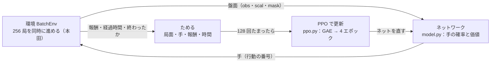

# はさみ将棋AI 学習担当マニュアル（11/12〜11/25）

2026-11-12 作成、11/16 更新（Claude Docs から GitHub へ移した。続きからの学習、テストの数、第7章のリーグを足した）、11/17 更新（チェックリストを進み具合に合わせた。評価と攻略役を 7-7 の 1 つのコマンドにまとめた。リーグの図を 7-8 に足した。push の認証を個人のトークンにした。夕方、評価と攻略役の結果を 6-4 と 7-7 の表に書き込んだ）、本田

このマニュアルの順に進めると、11/25 の発表に使う学習した AI と評価の表ができます。各章の最後にある「確認」ができたら、次の章へ進んでください。わからないところは、本田に連絡してください。コマンドは、GitHub で見ると各ブロックの右上のボタンでコピーできます。

## はじめに

この演習では、はさみ将棋の機械側の AI を、強化学習（PPO）で学習させます。人間側は、学習用の環境の中に入っている人間役のボットが指します。あなたの担当は、学習を回すことと、学習した AI の強さを測って発表の表にすることです。

| 担当 | 作るもの | リポジトリの場所 |
| --- | --- | --- |
| 本田 | 学習用の環境（ゲームのシミュレーター）。できていて、演習の VM で動くことも確認済み | `lib/core`、`python/hasami_env` |
| あなた | 学習と評価を回し、発表の表を作る（プログラムのひな形は用意済み） | `python/train/` |

学習は、下の図の「1周」を何千回も繰り返します。第4章のひな形は、この図のとおりに書いてあります。



本番の学習では、この 1 周を約 900 回くり返します（3,000 万決定点）。

1 周ごとに、256 局 × 128 回＝32,768 手分の経験で、ネットを少しだけ直します。

## 締め切りのチェックリスト

終わったものからチェックを付けてください。発表は 11/25 です。11/17 の時点で、学習は予定より 2 日ほど早く進んでいます。

### 済んだこと（11/16〜17）

- [x] 第1章・第2章・第4章: VM の準備、テスト、短い学習
- [x] 第5章: 本番の学習（相手 B1、速さ 1.0）が 3,000 万決定点まで終わった（11/16、あなたの VM）
- [x] 学習曲線が上がった（学習中の B1 への勝率 0 → 0.96。Random のボットでの確かめは、B1 にここまで勝てているので省いた）
- [x] 速さ 0.7 と 1.3 の学習も 3,000 万決定点まで終わった（11/16 夜〜17、本田の VM。予定は 11/19 だった）
- [x] 速さ 1.0 のリーグが 2000 回の更新まで終わった（11/16、あなたの VM）
- [x] 速さ 1.3 のリーグが 2000 回の更新まで終わった（11/17、本田の VM）
- [x] ここまでの結果がすべて main に入った（`runs/b1_s07`、`b1_s10`、`b1_s13`、`league_s10`、`league_s13`。11/17）
- [x] 3 本の学習曲線と、リーグの勝率の図ができた（`runs/curves.png`、`runs/league_curves.png`。7-8）

### 11/17（あなた）

- [x] 最新を取り込む（7-2）
- [x] 評価 5 本と攻略役 3 本を、1 つのコマンドで続けて回す（7-7。1 時間ほどで終わった）
- [x] 今の読みの数字が、6-2 の基準と一致している（58.0%、18.5%）
- [x] 評価と攻略役の結果を push する（`results/aiexp-08`）

### 11/17〜18（本田）

- [x] 速さ 0.7 のリーグを終える（11/17 の 17 時すぎ）
- [x] 0.7 のリーグを push し、評価する（7-7 の最後）
- [x] 3 本のリーグを並べた図を作る（7-8）
- [x] 評価と攻略役の結果を main に入れる（PR）
- [x] 速さ 1.3 と 0.7 の機械にも攻略役を当てる（7-7 の最後。11/17 夜）
- [x] その結果を push し、7-7 の攻略役の表に書き足す

### 11/24 まで（2 人）

- [ ] 評価の表（6-4 の 2 つの表と、7-7 の 2 つの表）を埋める
- [ ] 対局の録画（GIF）を作る（6-5）
- [ ] スライドに評価の表と学習曲線を載せる
- [ ] 発表で話す分担を決める

## 第1章 VM の準備

演習の VM に、学習用の環境（hasami_env）を入れます。VM には C++ のコンパイラがないので、本田がビルドしておいた wheel（Python のパッケージのファイル）を入れます。かかる時間は 10 分ほどです。

### 1-1 VM を起動してつなぐ

Azure ポータルで自分のマシン（aiexp-XX）を開き、「開始」を押します。「実行中」になったら、自分のパソコンのターミナルでつなぎます（演習の利用手順の第3章と同じです）。

```bash
ssh -i ~/.ssh/id_rsa_aiexp u(10桁の共通ID)@IPアドレス
```

画面が `ユーザー名@aiexp-XX:~$` のようになればつながっています。ここから先のコマンドは、すべて VM の中で打ちます。

### 1-2 リポジトリを取ってくる

```bash
git clone https://github.com/SoyaHonda/hasami-shogi.git ~/hasami-shogi
```

### 1-3 環境を入れる

まずフォルダーを移って、演習の Python 環境を有効にします。行の先頭に `(venv)` が付けば有効です。

```bash
cd ~/hasami-shogi && source ~/venv/bin/activate
```

次に、必要なパッケージと wheel を入れます。numpy と PyTorch は入れ替わりません。

```bash
python -m pip install -r python/requirements.txt && python -m pip install --force-reinstall --no-deps python/wheels/hasami_env-0.1.0-cp312-cp312-linux_x86_64.whl
```

最後に `Successfully installed hasami-env-0.1.0` と出れば入っています。

### 1-4 テストを回す

```bash
python -m pytest python
```

1 分ほどで、次のように出れば成功です。`/home/...` と `SOURCE_HASH` のあとは、人や時期によって違います。`test_env.py` は学習用の環境の 15 件、`test_train.py` は学習のプログラムの 7 件です（VM には PyTorch が入っているので、学習のテストもここで動きます）。

```text
hasami_env: not built here, from /home/u.../venv/lib/python3.12/site-packages/hasami_env, SOURCE_HASH 810d96c0a6a9941b
collected 22 items

python/tests/test_env.py ...............                               [ 68%]
python/tests/test_train.py .......                                     [100%]

============= 22 passed in 55.00s =============
```

確認: 最後が `22 passed` になった。

次に VM につないだときも、毎回 `cd ~/hasami-shogi && source ~/venv/bin/activate` から始めます。

## 第2章 環境を動かしてみる

学習の前に、機械にランダムな手を指させて、環境の使い方を体験します。256 局を同時に進め、合わせて 500 局ほど終わるまで回します。

### 2-1 スクリプトを実行する

スクリプトは `python/train/try_random.py` に入っています。`~/hasami-shogi` にいることを確かめてから（`python` フォルダーの中では動きません）、次のコマンドを打ちます。10 秒ほどで終わります。

```bash
python python/train/try_random.py
```

中身は `less python/train/try_random.py` で読めます（q で終わる）。256 局を同時に進め、機械には選べる手（`mask` が True のもの）の中からランダムに 1 つを選ばせ、終わった局（`done`）の勝敗と枚数を数えています。第3章の説明と見比べると、環境の使い方がわかります。

### 2-2 結果を確かめる

次のとおりに出れば正しく動いています。乱数の種を固定しているので、最後の行のほかは誰がやっても同じ数字になります。

```text
obs (256, 12, 7, 7) scal (256, 6) mask (256, 1177)
最初に選べる手の数: 35  動かない(1176)を選べるか: False
502 局: 機械の勝ち 0、取った枚数/局 0.07、失った枚数/局 4.11
決定点/秒 3000 前後（ここだけは測るたびに変わる）
```

ランダムに指す機械は B1 に 1 局も勝てず、たいてい 4 枚取られて負けます。学習はここから始まります。

確認: 3 行目までが上と同じになった。

## 第3章 環境の中身を知る

学習のプログラムを読むために必要なことだけをまとめます。ルールは固定で、先に 4 枚取ったほうが勝ち、10 分で時間切れ（取った枚数が多いほうの勝ち）です。

### 3-1 step で起きること

`env.step(actions)` を呼ぶと、環境は 256 局それぞれで、渡された手を機械に指させて時間を進め、機械が次に手を選ぶ時点（決定点）で止まって結果を返します。決定点は 0.25 秒以上おきに来ますが、機械が駒を動かしている間は来ません。局が終わった環境は、自動で次の局を始めます。

| 名前 | 形 | 意味 | 使い道 |
| --- | --- | --- | --- |
| `obs` | [256, 12, 7, 7] | 盤の様子を 12 枚の 7×7 の絵で表したもの（下の表） | ネットの入力 |
| `scal` | [256, 6] | 盤全体の数（下の表） | ネットの入力 |
| `mask` | [256, 1177] | 今選べる手が True | 選べない手を選ばないようにする |
| `reward` | [256] | 前の決定点からの報酬 | 学習 |
| `dt_ms` | [256] | 前の決定点からの時間（ミリ秒） | 割引の計算 |
| `done` | [256] | その局が終わったか | 局の境目を切る |
| `info` | dict | 終わった局の勝敗（`winner`: 2 機械、1 人間、0 引き分け）、取った枚数（`captures`）など | 記録と評価 |

`done` が True の環境では、`obs`・`scal`・`mask` はもう次の局のものです。`reward`・`info` は終わった局のものです。

### 3-2 盤の 12 枚と scal

時間は 100 ミリ秒単位で、例えば 10 は 1 秒です。

| 番号 | obs の中身 | 値 |
| --- | --- | --- |
| 0 | 機械の駒 | 1 |
| 1 | 人間の駒 | 1 |
| 2 | 人間が持ち上げている駒の元のマス | 1 |
| 3 | 人間の駒が置かれる予定のマス | 1 |
| 4 | 人間が次に置けるまでの残り時間（盤全体に同じ値） | 0〜10 |
| 5 | 機械の駒がまた動けるまでの残り（クールダウン） | 0〜10 |
| 6 | 人間の駒のクールダウンの残り | 0〜30 |
| 7 | 機械の駒が「40 秒動かさないと隣に来られただけで取られる」ルールで取られうるようになるまでの残り | 0〜400 |
| 8 | 人間の駒の同じ残り | 0〜400 |
| 9 | 機械のヘッド（駒を動かす磁石）の位置 | 1 |
| 10 | 人間が駒を持ち上げてからの時間 | 0〜10 |
| 11 | 端で囲まれて、空きマスがあと 1 つしかない駒のまとまり | 1 |

scal の 6 つは、機械が取った枚数、人間が取った枚数、残り時間（6000 が 10 分）、Opening 中か（0 か 1）、人間が最初の一手を指したか（0 か 1）、機械の速さの倍率×100 です。Opening は、対局の始めに両者が 1 手ずつ指す時間で、この間は「動かない」を選べません。

### 3-3 行動の番号

行動は 0〜1176 の番号で渡します。1176 は「動かない」です。それ以外は、動かす駒のマス (r, c)、方向 d、マスの数 dist から決まります。

```text
番号 = ((r × 7 + c) × 4 + d) × 6 + (dist − 1)
  r    段。0 が機械の一段目、6 が人間の一段目
  c    筋。0 が左端
  d    方向。0 下（人間のほうへ）、1 上、2 右、3 左
  dist 1〜6 マス
例: (0, 3) の駒を下へ 2 マス → ((0×7+3)×4+0)×6+1 = 73
```

第2章で「最初に選べる手の数: 35」だったのは、Opening で「動かない」が選べず、一段目の 7 枚がそれぞれ下へ 1〜5 マス動けるからです。

### 3-4 報酬

勝ちは +1、負けは −1 です。途中でも、駒を 1 枚取るごとに +0.2、取られるごとに −0.2 が入ります。取った枚数が同じままのあいだは、少しずつ減らされます（10 分で −0.5）。引き分けに逃げさせないためです。

### 3-5 用語

| 用語 | 意味 |
| --- | --- |
| 決定点 | 機械が手を選ぶ時点。0.25 秒以上おき |
| マスク | 今選べる手の一覧（True が選べる） |
| 方策 | 局面から、どの手をどれくらいの確率で選ぶかを出すもの |
| 価値 | 局面から、この先もらえる報酬の見込みを出すもの |
| 割引 | 先の報酬ほど軽く数えること。ここでは 120 秒先の報酬を半分に数える |
| アドバンテージ | その手が、いつもよりどれだけ良かったか。GAE という方法で計算する |
| PPO | 方策を少しずつ（一度に大きく変えすぎないように）更新する強化学習の方法 |
| B1・Race・Random | 人間役のボット。Race は速くて強い。B1 は考える時間と見落としがある Race。Random はでたらめ |
| speed_scale | 機械の速さの倍率。0.7 は遅く、1.3 は速い |
| 今の読み | 人が手で作った機械の AI。`env.read_actions()` で、その手を取り出せる |

## 第4章 学習のプログラムを置く

学習のプログラムは、1-2 で取ってきたリポジトリの `python/train/` に入っています。まずはそのまま動かし、動いたら必要に応じて直してください。

### 4-1 最新にする

本田がプログラムを直したら、次の 2 つで取り込みます。この章を始めるときと、本田から更新を知らせたときに打ってください。

```bash
cd ~/hasami-shogi && source ~/venv/bin/activate && git pull --no-edit origin main
```

```bash
python -m pip install --force-reinstall --no-deps python/wheels/hasami_env-0.1.0-cp312-cp312-linux_x86_64.whl
```

1 つ目は main の更新を取り込みます。`origin main` を省いた `git pull` は、今いるブランチの更新しか取ってきません。自分のブランチにいるときは、`git pull` だけでは main の更新が来ず、Already up to date と出てしまいます。`--no-edit` は、手元に結果のコミットがあるときに取り込みのメッセージを書く画面が開かないようにするためのものです。2 つ目は wheel の入れ直しです。本田が C++ を変えると wheel も作り直されますが、pip で入れたものは git pull では入れ替わりません。変わっていないときに打っても害はないので、毎回打ってください。

### 4-2 テストで確かめる

```bash
python -m pytest python
```

最後が `22 passed` になれば、学習・評価・学習曲線・録画・続きからの学習・リーグのプログラムが、あなたの VM で一通り動いています（1 分ほど）。`python/tests/test_train.py` が、小さな設定（8 局 × 16 回 × 2 周）で学習を最後まで回し、途中で止めた学習を続きから再開できるか、小さなリーグと攻略役が動くかも確かめます。

### 4-3 中身を知る

| ファイル | 中身 |
| --- | --- |
| `model.py` | ネットワーク。盤 12 枚と scal 6 個を、畳み込みと残差ブロック 2 つに通し、マスごとに 24 個（方向 4 × 距離 6）と「動かない」1 個の点数、それに価値を出す。選べない手は −10 億点にして選ばれないようにする |
| `ppo.py` | 学習の手順。はじめにの図の 1 周をそのまま書いたもの（下の表） |
| `evaluate.py` | 学習した AI と今の読みを同じ 200 局で比べる（第6章） |
| `plot_curve.py` | 学習曲線を描く（第5章） |
| `record_game.py` | 1 局を GIF にする（第6章） |
| `league.py` | リーグと攻略役（第7章） |
| `plot_league.py` | リーグの勝率を速さごとに並べて描く（7-8） |

| `ppo.py` の部分 | やっていること |
| --- | --- |
| 1) 集める | 256 局で 128 回ずつ手を選び、局面・手・報酬・時間をためる（合わせて 32,768 個） |
| 2) アドバンテージ | 各手がどれだけ良かったかを、時間で割り引いて計算する（120 秒先の報酬は半分） |
| 3) 更新する | ためたデータを 4,096 個ずつに分け、4 回くり返してネットを少しずつ直す |
| 4) 記録する | 勝率などを `log.csv` に書き、50 回ごとと最後に `model.pt`（評価に使うネット）と `checkpoint.pt`（続きから学習するためのもの）を保存する |

中身は `less python/train/ppo.py` で読めます（q で終わる）。設定値（環境 256、集める長さ 128、エポック 4、ミニバッチ 4096、学習率 3e-4、クリップ 0.2、エントロピー 0.01）はプロジェクトの計画の値です。まずはこのまま使ってください。`--envs` や `--rollout` などで変えられます。

### 4-4 短く動かしてみる

```bash
python python/train/ppo.py --steps 300000 --out runs/test
```

9 回更新して終わります（2〜3 分）。更新のたびに次のような行が出ます（数字は一例です）。最初は勝率（`win`）がほぼ 0 で、それで正常です。

```text
update 1/9  steps 32768  games 2700  win 0.000  taken 0.07  lost 4.11  2500 steps/s
```

確認: `update 9/9` まで出て、`runs/test/` に `log.csv` と `model.pt` ができた。

## 第5章 学習を回す

本番の学習（3,000 万決定点）は 3 時間ほどかかります。SSH が切れても止まらないように、tmux の中で回します。

### 5-1 tmux の中で学習を始める

tmux の画面を開きます。

```bash
tmux new -s train
```

開いた画面で、学習を始めます。

```bash
cd ~/hasami-shogi && source ~/venv/bin/activate && python python/train/ppo.py --opponent b1 --speed-scale 1.0 --out runs/b1_s10
```

`update 1/915` のような行が出始めたら、Ctrl+b を押してから d を押して画面を抜けます。学習は続きます。画面に戻るときは `tmux attach -t train` です。

VM が止まるなどして学習が途中で止まったときは、tmux の画面を開き直して、次のコマンドで続きから学習できます。最後に保存した更新（50 回ごと）から始まり、相手や速さなどの設定は前の学習のものを引き継ぎます。保存より後に進んでいた分（最大 50 回の更新、10 分ほど）はやり直しになります。

```bash
cd ~/hasami-shogi && source ~/venv/bin/activate && python python/train/ppo.py --out runs/b1_s10 --resume
```

### 5-2 進み具合を見る

更新のたびに `runs/b1_s10/log.csv` に 1 行ずつ足されます。最後の 5 行を見るには:

```bash
tail -n 5 runs/b1_s10/log.csv
```

| 列 | 意味 | 良くなっているとき |
| --- | --- | --- |
| `update` | 何回目の更新か |  |
| `steps` | そこまでに使った決定点の数 |  |
| `games` | その更新の間に終わった局の数 | 減っていく（1 局が長くなる） |
| `win_rate` | その局のうち機械が勝った割合 | 上がっていく |
| `taken` | 1 局あたり機械が取った枚数 | 上がっていく |
| `lost` | 1 局あたり機械が取られた枚数 | 下がっていく（始めは約 4） |
| `game_min` | 1 局の長さ（分） |  |
| `steps_per_s` | 1 秒あたりの決定点 | 2,000 以上が目安 |

学習曲線の図は、次のコマンドで `runs/b1_s10/curve.png` にできます（学習中でも作れます）。左が勝率、右が取られた枚数です。

```bash
python python/train/plot_curve.py runs/b1_s10
```

3 本の学習を重ねて描くときは、フォルダーを並べます（`runs/curves.png` にできます）。

```bash
python python/train/plot_curve.py runs/b1_s07 runs/b1_s10 runs/b1_s13
```

自分のパソコンで見るには、パソコンのターミナルで取ってきます。

```bash
scp -i ~/.ssh/id_rsa_aiexp u(10桁の共通ID)@IPアドレス:~/hasami-shogi/runs/b1_s10/curve.png .
```

### 5-3 11/17 の目安

学習が進んでいれば、`win_rate` が 0 から上がり、`lost` が約 4 から下がっていきます。Random のボットに勝ち越したかは、第6章の評価で確かめます。1〜2 時間たっても `win_rate` が 0 のままなら、5-4 へ進んでください。

### 5-4 学習が進まないとき

相手を Random に下げ、取りの報酬を 0.2 から 0.5 に上げて、学習そのものが進むことを先に確かめます（30 分ほど）。

```bash
python python/train/ppo.py --opponent random --capture-reward 0.5 --steps 5e6 --out runs/random_cr05
```

これで `win_rate` が上がれば、プログラムは正しく動いています。B1 に戻して、学習の量（`--steps`）を増やします。上がらなければ、「困ったとき」を見てください。

### 5-5 3 本を並べて回す（11/17 に 3 本とも済んだ）

3 本とも 3,000 万決定点まで終わり、main の `runs/b1_s07`、`runs/b1_s10`、`runs/b1_s13` に入っています。この節は、回し直すときのために残しています。

機械の速さを 3 通りにして学習します。VM は 2 人で 2 台（あなたのものと本田のもの）あるので、速さ 1.0 はあなたの VM、0.7 と 1.3 は本田の VM で回します。VM は 1 台あたり 4 vCPU なので、2 本を同じ VM で回すときは `--threads 2` にし、tmux の画面を分けます（`tmux new -s s07` と `tmux new -s s13`）。

| 学習 | 回す VM | コマンドの後ろに付けるもの |
| --- | --- | --- |
| 速さ 1.0（11/17 のもの） | あなた | `--speed-scale 1.0 --out runs/b1_s10` |
| 速さ 0.7（遅い機械） | 本田 | `--speed-scale 0.7 --threads 2 --out runs/b1_s07` |
| 速さ 1.3（速い機械） | 本田 | `--speed-scale 1.3 --threads 2 --out runs/b1_s13` |

確認: `log.csv` の `win_rate` が上がっていて、学習の終わりに `model.pt` ができた。

## 第6章 評価する

学習した AI と今の読み（人が作った AI、つよい）を、同じ 200 局で戦わせて比べます。200 局は乱数の種を固定してあるので、何度やっても、どちらの AI でも同じ相手の動きから始まります。

### 6-1 evaluate.py について

`python/train/evaluate.py` は、学習した AI（`--model` で指定）と今の読みを、相手ごとに同じ 200 局で戦わせ、勝率などを 1 行ずつ出します。`--model` を付けなければ、今の読みだけを測ります。

### 6-2 まず今の読みだけで確かめる

```bash
python python/train/evaluate.py --opponents b1,race
```

1 分半ほどで、次の 3 行が出ます。この数字は誰がやっても同じになります（プロジェクトの計画にある数字とも一致します）。

```text
player   opponent  win     draw    taken  lost   outside
read     b1         58.0%    0.0%   3.19   2.33   44.1%
read     race       18.5%    0.5%   1.85   3.77   45.7%
```

| 列 | 意味 |
| --- | --- |
| `win` | 機械の勝率 |
| `draw` | 引き分けの割合 |
| `taken` | 1 局あたり機械が取った枚数 |
| `lost` | 1 局あたり機械が取られた枚数 |
| `outside` | 機械の駒が自分の一段目の外にいた時間の割合（大きいほど攻めている） |

確認: 3 行が上と同じになった。

### 6-3 学習した AI を評価する

```bash
python python/train/evaluate.py --model runs/b1_s10/model.pt --speed-scale 1.0
```

相手 B1・Race・Random のそれぞれで、今の読み（`read`）と学習した AI（`learned`）の行が出ます（5 分ほど）。

11/17 からは、この節と 6-4 のコマンドを 1 つずつ打つ代わりに、7-7 のコマンドで 5 本の AI をまとめて評価します。出た数字で埋めるのは、6-4 の表です。

### 6-4 発表の表を作る

発表の中心になるのは、速さ 1.0 での次の表です。1 行目を 6-3 の結果で埋めます。

| AI | ルール | B1 勝率 | B1 取られた枚数 | Race 勝率 | Race 取られた枚数 |
| --- | --- | --- | --- | --- | --- |
| 学習した AI | RE＋RW＋RU40（正式） | 96.5% | 1.01 | 44.0% | 3.33 |
| 今の読み（つよい） | RE＋RW＋RU40（正式） | 58.0% | 2.33 | 18.5% | 3.77 |
| 今の読み（つよい、参考） | RE＋RW（RU なし） | 82.5% | 1.04 | 29.0% | 3.24 |

表の読み方は次のとおりです。

- 主な物差しは、1 行目の B1 と Race への勝率です。相手を固定した数字なので、今の読みの強さに左右されません。プロジェクトの目標は「つよいは、現実的な人間（B1）に 7 割以上」です。
- 2 行目は、同じルールでの比較です（6-2 の数字と同じ）。
- 3 行目は、RU がなければ手書きの読みでもここまで勝てる、という参考です。`evaluate.py` は正式のルールでしか測れないので、本田が同じ 200 局（種 1〜200）を別に測った数字です。

発表の筋は、「RU で砦はなくなったが、手書きの読みは B1 への勝率が 82.5% から 58.0% に落ちた。学習でそれを取り戻し、目標の 7 割を超えられるか」です。今の読みの前進の重みを 60〜180 に変えると、RU40 の下では B1 への勝率が 38〜55% に下がりました。つまり 2 行目は、わざと弱くした相手ではなく、手で作れた範囲でいちばん強い読みです。

速さ 0.7 と 1.3 の AI も、同じ速さの環境で評価します。今の読みもその速さで一緒に測られます。コマンドは 7-7 にまとめてあり、結果は `runs/eval/b1_s07.txt` などに残ります。

速さの実験は、出た数字で次の表を埋めます。問いは「遅い機械でも、AI の読みで補えるか」です。

| 速さ | AI | B1 勝率 | B1 取られた枚数 | Race 勝率 | Race 取られた枚数 | 外にいた割合（B1） |
| --- | --- | --- | --- | --- | --- | --- |
| 1.0 | 今の読み | 58.0% | 2.33 | 18.5% | 3.77 | 44.1% |
| 1.0 | 学習 | 96.5% | 1.01 | 44.0% | 3.33 | 35.7% |
| 0.7 | 今の読み | 17.0% | 3.70 | 2.0% | 4.23 | 32.1% |
| 0.7 | 学習 | 92.5% | 1.66 | 42.0% | 3.37 | 54.8% |
| 1.3 | 今の読み | 78.0% | 1.61 | 42.5% | 3.07 | 52.2% |
| 1.3 | 学習 | 99.0% | 0.24 | 65.0% | 2.18 | 44.8% |

（11/17 に測った。`runs/eval/b1_s07.txt`、`b1_s10.txt`、`b1_s13.txt`）学習した AI は、どの速さでも B1 に 9 割以上勝った。速さ 0.7 の学習した AI（92.5%）は、速さ 1.3 の今の読み（78.0%）より強い。遅い機械でも、読みで補えることになる。

### 6-5 対局を録画する

学習した AI の 1 局を GIF にします。赤が機械の駒、青が人間の駒、点線が持ち上げ中の駒、× が機械のヘッドです。決定点ごとの盤なので動きは飛び飛びで、最後に駒を取った瞬間の盤は入りません。`--seed` を変えると別の局になります。

```bash
python python/train/record_game.py runs/b1_s10/model.pt --opponent b1 --seed 7 --out runs/game.gif
```

確認: `runs/game.gif` ができ、scp で手元に取ってきて開けた。

## 第7章 リーグ（自己対局）

速さ 1.0 の学習が終わったら、その AI を出発点にして、人間側も学習させる「リーグ」を回します。TA の助言（人間を模したボットに勝つのは一区切りなので、AlphaZero のような自己対局で強くする、比べる相手を工夫する）を受けて 11/16 に足しました。考え方はプロジェクトの計画（`plans/2026-11-12_ai-enshu-scope.md` の 7 章）にあります。

リーグは、速さごとに 1 本ずつ回しています。

| リーグ | 回した VM | 進み具合 | 結果の場所 |
| --- | --- | --- | --- |
| 速さ 1.0 | あなた | 11/16 に 2000 回まで終わった | main の `runs/league_s10` |
| 速さ 1.3 | 本田 | 11/17 に 2000 回まで終わった | main の `runs/league_s13` |
| 速さ 0.7 | 本田 | 11/17 に 2000 回まで終わった | main の `runs/league_s07` |

7-2 から 7-6 は 1.0 のリーグを始めたときの手順で、今は済んでいます。あなたがこれからやるのは 7-2（最新を取り込む）と 7-7（評価と攻略役）です。

### 7-1 何をするか

リーグでは、機械の AI（機械の主役）と人間側の AI（人間の主役）を同時に学習させます。人間の主役は、ボットではなくネットワークで人間の駒を動かし、今の機械に勝つ指し方を覚えます。指す速さには Race と同じ下限があり、置いてから 0.4 秒たたないと次の駒を選べず、持ち上げてから置くまで 0.5 秒 ±40% かかります。

機械の対局相手は 3 種類です。半分は今までどおり B1 で、現実的な人間に勝てることから離れないようにするためです。残りは、人間の主役か、人間の主役の過去の版です。過去の版は 50 回の更新ごとに保存され、機械がよく負ける版ほど多く選ばれます（PFSP という方法）。こうすると、機械は「今の人間の主役だけに効く癖」ではなく、いろいろな相手に通じる指し方を覚えます。

### 7-2 最新にする

4-1 の 2 つのコマンドで最新を取り込み、テストを回します。

```bash
cd ~/hasami-shogi && source ~/venv/bin/activate && git pull --no-edit origin main
```

```bash
python -m pip install --force-reinstall --no-deps python/wheels/hasami_env-0.1.0-cp312-cp312-linux_x86_64.whl && python -m pytest python -q
```

確認: 最後が `22 passed` になった。

### 7-3 速さ 1.0 の学習の結果を push する

VM は 11 月末に回収されるので、終わった学習の結果は先に push しておきます（Git の節。`bash tools/push_results.sh runs/b1_s10`）。評価はここではしなくて構いません。リーグは `runs/b1_s10/model.pt` を読み込むだけで上書きしないので、評価はリーグのあとでまとめてできます（7-7）。

### 7-4 リーグを始める

```bash
tmux new -s league
```

```bash
cd ~/hasami-shogi && source ~/venv/bin/activate && python python/train/league.py --init-machine runs/b1_s10/model.pt --speed-scale 1.0 --threads 3 --out runs/league_s10
```

`update 1/2000` のような行が出始めたら、Ctrl+b、d で抜けます。2000 回の更新で 7〜9 時間ほどの見込みです。VM で回すのはこれ 1 本だけなので `--threads 3` にしています（1 つは PyTorch に残す）。止まったときは、同じコマンドの代わりに次で続きから始めます（設定は前のものを引き継ぎます）。

```bash
python python/train/league.py --out runs/league_s10 --resume --threads 3
```

### 7-5 進み具合を見る

```bash
tail -n 3 runs/league_s10/log.csv
```

| 列 | 意味 | 正常な動き |
|---|---|---|
| `update` | 何回目の更新か | |
| `machine_steps`、`human_steps` | その更新で機械と人間の主役が手を選んだ回数 | どちらも 0 より大きい |
| `b1_games`、`b1_win`、`b1_lost` | B1 との局数、機械の勝率、取られた枚数／局 | 勝率は 1.0 の学習の終わりに近いところから始まり、大きく下がらない |
| `main_games`、`main_win`、`main_taken`、`main_lost` | 人間の主役との局数、機械の勝率、取った枚数、取られた枚数 | 最初は人間がでたらめなので勝率がほぼ 1。人間が学ぶにつれて下がっていく |
| `past_games`、`past_win` | 人間の過去の版との局数と機械の勝率 | 50 回目の更新を過ぎてから出てくる |
| `pool` | 保存された過去の版の数 | 50 回ごとに 1 つ増える（最大 30） |
| `steps_per_s` | 1 秒あたりの手の数（機械と人間の合計） | |

10〜20 分たったら最後の 3 行を見て、表の「正常な動き」と比べます。気をつけるのは 2 つです。`b1_win` が始めより大きく（たとえば半分以下に）下がり続けるときは、機械が人間の主役だけに合わせてしまっています。`main_win` が 1 時間たっても 1 に張り付いたままなら、人間側が学べていません。どちらかが起きたら、tmux の画面で Ctrl+c を押してリーグを止めます。

### 7-6 終わったら push する

リーグの結果は、ほかの学習とは別の `runs/league_s10` に保存されています（`log.csv` は毎回の更新、`machine.pt`・`human.pt`・`checkpoint.pt` は 50 回ごとと最後、`pool/` に人間の過去の版）。終わったら、まず push します（Git の節。`bash tools/push_results.sh runs/league_s10`）。分析はこのあと、11/24 までのいつでも構いません。

### 7-7 評価と攻略役（11/17〜18、あなたの VM）

評価も攻略役も、保存した `model.pt` と `machine.pt` を読むだけなので、いつやっても同じ結果になります。ただし、リーグを回している VM でやると CPU を取り合ってリーグが遅くなります。本田の VM は 0.7 のリーグで埋まっているので、あなたの VM で回します。

評価では、固定の相手で学習した AI 3 本と、リーグの AI 2 本を、それぞれの速さで B1・Race・Race3 と 200 局ずつ戦わせます（Race3 は、2〜3 回置いて取る手を探す、Race より強いボットです）。今の読みも同じ速さで一緒に測られます。攻略役は、決まった機械だけを狙って一から学習する人間側の AI で、その機械が弱点を探しに来る相手にどれだけ耐えるかを測ります。手書きの読み、固定の相手で学習した AI、リーグの AI の 3 つに当てます。

1 つずつ打つと待ち時間が長いので、全部を 1 つのコマンドで続けて回します。評価は 1 本 10 分ほど、攻略役は 1 本 20〜30 分で、合わせて 2 時間半ほどです。まず tmux の画面を開きます。

```bash
tmux new -s eval
```

開いた画面で、次を打ちます（全体で 1 つのコマンドです）。最初に main を取り込むので、7-2 を先に済ませていなくても構いません。

```bash
cd ~/hasami-shogi && source ~/venv/bin/activate && git pull --no-edit origin main && mkdir -p runs/eval && \
python -u python/train/evaluate.py --model runs/b1_s07/model.pt --speed-scale 0.7 --opponents b1,race,race3 | tee runs/eval/b1_s07.txt && \
python -u python/train/evaluate.py --model runs/b1_s10/model.pt --speed-scale 1.0 --opponents b1,race,race3 | tee runs/eval/b1_s10.txt && \
python -u python/train/evaluate.py --model runs/b1_s13/model.pt --speed-scale 1.3 --opponents b1,race,race3 | tee runs/eval/b1_s13.txt && \
python -u python/train/evaluate.py --model runs/league_s10/machine.pt --speed-scale 1.0 --opponents b1,race,race3 | tee runs/eval/league_s10.txt && \
python -u python/train/evaluate.py --model runs/league_s13/machine.pt --speed-scale 1.3 --opponents b1,race,race3 | tee runs/eval/league_s13.txt && \
python python/train/league.py --exploit read --updates 300 --threads 3 --out runs/exploit_read && \
python python/train/league.py --exploit runs/b1_s10/model.pt --updates 300 --threads 3 --out runs/exploit_s10 && \
python python/train/league.py --exploit runs/league_s10/machine.pt --updates 300 --threads 3 --out runs/exploit_league
```

`player   opponent ...` の見出しが出たら、Ctrl+b、d で抜けます。途中で見るときは `tmux attach -t eval` です。評価の結果は画面に出るだけでは消えてしまうので、`tee` で `runs/eval/` の 5 つのファイルにも書いています。

確認: `cat runs/eval/b1_s10.txt` の `read` の `b1` と `race` の行が、6-2 の数字（58.0%、18.5%）と同じになっている。速さ 1.0 の今の読みは誰が測っても同じになるので、違っていたら環境が古いか、別のものを測っています。

全部終わったら（`runs/exploit_league/log.csv` が 300 行目まで進んだら）、評価のファイルと攻略役の結果を push します。`runs/eval` は `push_results.sh` が拾わないファイルなので、先に `git add` します（Git の節）。

```bash
git add runs/eval && bash tools/push_results.sh runs/exploit_read runs/exploit_s10 runs/exploit_league
```

数字は次の 2 つの表にまとめます。1 つ目は、固定の相手で学習した AI とリーグの AI の比べです。`runs/eval/` のファイルの `learned` の行から写します。速さ 0.7 の行は、0.7 のリーグが終わってから本田が埋めます。

| 速さ | AI | B1 勝率 | B1 取られた枚数 | Race 勝率 | Race3 勝率 | Race3 取られた枚数 |
| --- | --- | --- | --- | --- | --- | --- |
| 1.0 | 固定の相手で学習（`b1_s10`） | 96.5% | 1.01 | 44.0% | 18.5% | 3.94 |
| 1.0 | リーグ（`league_s10`） | 95.5% | 0.82 | 41.5% | 10.5% | 3.98 |
| 1.3 | 固定の相手で学習（`b1_s13`） | 99.0% | 0.24 | 65.0% | 73.5% | 1.82 |
| 1.3 | リーグ（`league_s13`） | 99.0% | 0.26 | 55.5% | 55.0% | 2.48 |
| 0.7 | 固定の相手で学習（`b1_s07`） | 92.5% | 1.66 | 42.0% | 36.0% | 3.57 |
| 0.7 | リーグ（`league_s07`） | 97.5% | 1.29 | 36.0% | 30.5% | 3.50 |

（11/17 に測った）リーグの AI は、3 つの速さとも Race と Race3 への勝率が固定の相手で学習した AI より下がった。上がったのは 0.7 の B1 だけ。速さ 1.0 の今の読みは Race3 に 24.0% 勝つので、1.0 では学習した AI 2 本とも Race3 には今の読みより弱い。

2 つ目は攻略役の表です。攻略役の `log.csv` では、`main_win` が攻略役を相手にした機械の勝率、`main_lost` が攻略役に取られた枚数／局です。最後の 20 行（281〜300 回目）の平均を写します。`tail -n 20 runs/exploit_read/log.csv` で見られます。機械の勝率が高く、取られた枚数が少ないほど、攻略されにくい機械です。

| 速さ | 攻略役が狙った機械 | 機械の勝率（`main_win`） | 機械が取った枚数（`main_taken`） | 取られた枚数（`main_lost`） |
| --- | --- | --- | --- | --- |
| 1.0 | 今の読み（`exploit_read`） | 84.7% | 3.42 | 0.72 |
| 1.0 | 固定の相手で学習（`exploit_s10`） | 26.9% | 0.69 | 0.67 |
| 1.0 | リーグ（`exploit_league`） | 22.2% | 1.96 | 3.58 |
| 1.3 | 固定の相手で学習（`exploit_s13`） | 8.1% | 0.76 | 1.76 |
| 1.3 | リーグ（`exploit_league_s13`） | 58.0% | 3.26 | 2.40 |
| 0.7 | 固定の相手で学習（`exploit_s07`） | 11.9% | 0.12 | 0.01 |
| 0.7 | リーグ（`exploit_league_s07`） | 31.4% | 0.90 | 0.84 |

（11/17 に測った。最後の 20 回を局数で重みづけした平均）リーグの機械は、攻略役に 1 局あたり 3.6 枚取られた。攻略役は 100〜150 回目で攻め方を見つけ、そこから短い局で勝ち続けた。固定の相手で学習した機械は 0.7 枚しか取られないが、攻略役が守りを固めると自分も 0.5 枚ほどしか取れず、勝ち切れない。今の読みは攻略役にも 85% 勝つ。速さ 1.0 のリーグで 1,400 回目から機械が急に勝ち出したのは、強くなったのではなく、崩れた人間の主役と過去の版にだけ効く指し方に偏ったためと読める。攻略役は種 1 つ・300 回の結果なので、言えるのは「この設定のリーグでは、攻略されにくくはならなかった」まで。

速さ 1.3 と 0.7 でも、攻略役に取られた枚数はリーグの機械のほうが多かった（1.3 は 1.76 と 2.40、0.7 は 0.01 と 0.84）。ただし機械の勝率だけを見ると逆に見えるので、読み方に気をつける。人間側の報酬には引き分けの罰がないので、攻略役は機械に勝てないと、駒を動かさずに守って引き分けに持ち込むことを覚える。固定の相手で学習した機械は、0.7・1.0・1.3 のどれでも、この守りを崩せずに勝率が 8〜27% まで下がった（0.7 では 1 局に 0.12 枚しか取れない）。リーグの機械に対しては、攻略役は守りではなく攻めを覚えた。1.3 のリーグの攻略役は 300 回目でもまだ取る枚数が増えていて（50 回ごとに 0.29 → 2.48）、学習しきっていない。今の読みは守りを固める攻略役にも 85% 勝つので、固定の相手で学習した AI には「守る人間を崩せない」という、B1 との勝率には出ない弱点がある。

0.7 のリーグの評価は、本田が本田の VM で次のように回して push しました（11/17）。

```bash
python -u python/train/evaluate.py --model runs/league_s07/machine.pt --speed-scale 0.7 --opponents b1,race,race3 | tee runs/eval/league_s07.txt
```

```bash
git add runs/eval && bash tools/push_results.sh runs/league_s07
```

速さ 1.3 と 0.7 の機械に当てる攻略役 4 本も、本田の VM で続けて回して push しました（11/17 夜、1 時間ほど）。

```bash
python python/train/league.py --exploit runs/b1_s13/model.pt --speed-scale 1.3 --updates 300 --threads 3 --out runs/exploit_s13 && \
python python/train/league.py --exploit runs/league_s13/machine.pt --speed-scale 1.3 --updates 300 --threads 3 --out runs/exploit_league_s13 && \
python python/train/league.py --exploit runs/b1_s07/model.pt --speed-scale 0.7 --updates 300 --threads 3 --out runs/exploit_s07 && \
python python/train/league.py --exploit runs/league_s07/machine.pt --speed-scale 0.7 --updates 300 --threads 3 --out runs/exploit_league_s07
```

```bash
bash tools/push_results.sh runs/exploit_s13 runs/exploit_league_s13 runs/exploit_s07 runs/exploit_league_s07
```

### 7-8 リーグの図を作る

3 本の学習を重ねた図（5-2）に加えて、リーグの機械の勝率を、B1・人間の主役・人間の過去の版のそれぞれについて、速さごとに 1 本の線で描きます。線は、前後 25 回の更新の局数で重みをつけた平均です。どの図でも、0.7 は青、1.0 は橙、1.3 は緑の線になります。

```bash
python python/train/plot_league.py runs/league_s07 runs/league_s10 runs/league_s13
```

`runs/league_curves.png` にできます。3 本を並べた図は、main の `runs/league_curves.png` に入っています（11/17）。

図から読めること: B1 への勝率は 3 本とも下がらなかった。人間の主役への機械の勝率は、1.3 では 0.6〜0.9 で動き続け、0.7 では 0.15〜0.5 と人間の主役に負け越したまま終わった。1.0 だけが、1,400〜1,550 回目に 0.2 から 1.0 近くへ跳ね、過去の版への勝率も同じころ 0.98 まで上がった（7-7 の攻略役の結果を参照）。

## 困ったとき

たいていのエラーは、Python 環境を有効にし忘れたか、実行した場所が違うかです。まず `cd ~/hasami-shogi && source ~/venv/bin/activate` を打ち直してから、下の表を見てください。

| 症状 | 主な原因 | 対処 |
| --- | --- | --- |
| `No module named 'hasami_env'` か `No module named 'hasami_env._core'` | Python 環境が有効でない、wheel を入れていない、`python` フォルダーの中で実行した | `~/hasami-shogi` で実行する。1-3 をやり直す。`PYTHONPATH` に `python/` を入れない |
| `No module named 'model'` | `model.py` が `python/train/` にない | 4-1 の git pull をやり直す。`python python/train/ppo.py` の形で実行する |
| テストで `test_build_matches_sources` だけが落ちる | 本田が C++ を変え、wheel が古い | 4-1 の 2 つのコマンドを打ち直す |
| `git pull` しても Already up to date で、本田が直したはずのファイルが来ない | 今いるブランチが main ではない（`git status -sb` の 1 行目でわかる） | `git pull --no-edit origin main` で main の更新を取り込む（4-1） |
| テストの数が 22 より少ない | 古いプログラムのまま | 4-1 の 2 つのコマンドを打つ |
| `git pull` で `untracked working tree files would be overwritten by merge` と出て止まる | 手元にだけあるファイル（`runs/test` など）と同じ名前のファイルが main に入った | 挙がったフォルダーの名前を変えてよけ（`mv runs/test runs/test_old` など）、同じコマンドを打ち直す |
| `git pull --no-edit origin main` で `CONFLICT` と出る | 自分で直したファイルと、本田が直したファイルがぶつかった | `git merge --abort` で取り込む前に戻す。自分で直したファイルを別の名前で写しておき、`git checkout -- ファイル名` で元に戻してから、4-1 をやり直す |
| `No module named 'league'` か、リーグのテストがない | リーグを足す前のプログラムのまま | 4-1 の 2 つのコマンドを打つ |
| `ValueError: action ... is not in its mask` | 選べない手を渡した | `model.py` の `masked_fill(~mask, -1e9)` を消していないか、別の step の mask を使っていないか確かめる |
| `steps_per_s` が 1,000 より小さい | ほかの学習と CPU を取り合っている | 同じ VM で 2 本回すときは両方 `--threads 2` にする。`top` で動いているものを見る |
| `win_rate` がずっと 0 | 学習が進んでいない | 5-4 を試す。Random 相手でも上がらなければ、`permute` や `nonterminal` の行を書き換えていないか確かめる |
| `torch.cuda.is_available()` が False | Python 環境が有効でない | `source ~/venv/bin/activate`。それでも False なら `nvidia-smi` の出力を TA に送る |
| SSH が切れた | ネットワーク | tmux の中なら学習は続いている。つなぎ直して `tmux attach -t train` |
| 学習が途中で止まった（VM を止めたなど） | VM を止めると tmux の中も止まる | `--out` を同じにして `--resume` を付けると、50 回ごとに保存した `checkpoint.pt` から続く（5-1）。50 回目より前に止まったときは最初からやり直す |
| push で `Password authentication is not supported` と出る | Password の欄に GitHub のパスワードを入れた | パスワードの代わりに個人のトークンを入れる（Git の節） |
| push で `Authentication failed` か 403 と出る | トークンが違うか、期限が切れているか、Contents の書き込みの権限がない | トークンを作り直す（Git の節）。古いものは `rm ~/.git-credentials` で消してから push し直す |
| `No space left on device` | ディスクがいっぱい | `df -h` と `du -sh runs/*` で確かめ、要らない `runs` の中身を消す |

## 決まりごと

### 分担

| やること | 本田 | あなた |
| --- | --- | --- |
| 学習用の環境（C++、pybind11、wheel） | 作った。直すのも本田 | 使う。足りないものは本田に頼む |
| 学習のプログラム（`python/train`） | ひな形を用意した | 使って、必要に応じて直す |
| 学習（速さ 1.0） |  | 11/16 に済んだ |
| 学習（速さ 0.7 と 1.3） | 11/17 に済んだ |  |
| リーグの環境（人間側も Python から指す DuelEnv）とプログラム（`league.py`） | 作った。直すのも本田 | 使う |
| リーグ（速さ 1.0） |  | 11/16 に済んだ |
| リーグ（速さ 1.3 と 0.7） | 11/17 に済んだ |  |
| 評価（5 本）と攻略役（3 本） |  | 11/17 に済んだ（7-7） |
| 0.7 のリーグの評価、リーグの図、結果を main に入れる PR | 11/17 に済んだ |  |
| 速さ 1.3 と 0.7 の攻略役（4 本） | 11/17 夜に済んだ |  |
| 評価の表、対局の GIF（11/24 まで） | 0.7 の行を埋める | 表を埋め、GIF を作る |
| スライド | 構成を確かめる | 下書きを作る |
| 発表で話す分担 | 2 人で決める | 2 人で決める |

リーグは小さな版をやります（第7章）。参照方策への KL 正則化、制約つき PPO、整数の推論と ESP32・Web への書き出し、RaceTime を入力に入れること、模倣学習から始めることはやりません（12 月以降に回します）。VM では C++ をビルドできないので、C++ の変更と wheel の作り直しは本田がやります。

### Git

学習の結果は、`tools/push_results.sh` で push します。VM ごとに `results/VM の名前`（`results/aiexp-03` など）というブランチに入るので、2 台がぶつかることはなく、main も書き換えません。main に入れるのは、本田が PR を作ってマージします。

GitHub は、push のときにアカウントのパスワードを受け付けません。Password の欄には、自分のアカウントで作ったトークンを入れます。すでにその VM から push できている人は、この準備はいりません。

トークンは、GitHub の右上のアイコンから Settings、Developer settings、Personal access tokens、Fine-grained tokens、Generate new token の順に進んで作ります。変えるのは 3 つだけです。Expiration は 30 日（VM は 11 月末に回収されます）、Repository access は Only select repositories で `hasami-shogi` だけ、Permissions は Repository permissions の Contents を Read and write にします。出てきた `github_pat_` で始まる文字列は 1 回しか表示されないので、コピーしておきます。

VM で、入れたトークンを覚えておく設定をします。最初の push で Username に GitHub のユーザー名、Password にトークンを入れると、`~/.git-credentials` に保存され、次からは聞かれません。このトークンで書き込めるのは `hasami-shogi` だけで、30 日で切れます。VM を返す前に、GitHub の同じページでトークンを消しておきます。

```bash
git config --global credential.helper store
```

結果を push するときは、学習のフォルダーを並べて打ちます。

```bash
bash tools/push_results.sh runs/b1_s10
```

```bash
bash tools/push_results.sh runs/league_s10
```

それぞれのフォルダーの `log.csv`、`model.pt`、`machine.pt`、`human.pt` のうちあるものをコミットして push し、最後に `pushed to results/...` と出ます。`checkpoint.pt` と `pool/` は続きから学習するためのものなので push しません。攻略役のフォルダー（`runs/exploit_read` など）も同じように push できます。評価の結果（`runs/eval`）や自分で直したプログラムのように、この 4 つ以外のファイルも一緒に入れたいときは、先に `git add runs/eval` や `git add python/train/直したファイル` を打ってから同じコマンドを打ちます。

`push_results: no changes since the last push; pushing again anyway` と出るのは、前に打ったときにコミットまではできていて、push だけが失敗していたときです。新しいコミットは作らずに、そのコミットを push し直すので、そのままで構いません。

### VM

- 学習中は止めなくて構いません。11/30 まで止めずに回しても約 240 ドル（1 日約 17 ドル）で、上限の $1,334.9 には届きません。
- 使わないときはポータルで「停止」を押し、「停止済み (割り当て解除済み)」になったことを確かめます。
- 上限を超えると中のファイルは取り出せなくなり、11 月末には VM が回収されます。結果はこまめに push するか、手元に取ってきてください。
